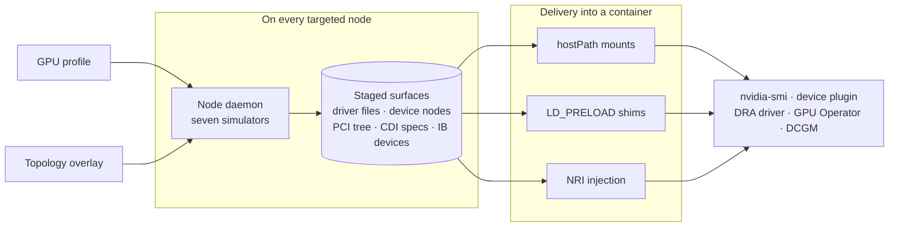

# 架构

Mokka 的核心思想是模拟非常底层的系统契约，从而让更高层的组件无需任何修改就能有意义地工作。

实现方式是模拟设备状态、PCI 树，以及 GPU 和网络设备的驱动脚印。我们操作的层次越低越好，因为这样可以扩大真实执行的工作流范围（而不是完全禁用或被 mock 掉）。

更高层的应用是我们的消费者：

- 平台组件，例如 [nvidia-smi](https://docs.nvidia.com/deploy/nvidia-smi/index.html)、[K8s DRA driver](https://github.com/kubernetes-sigs/dra-driver-nvidia-gpu)、[NFD](https://github.com/kubernetes-sigs/node-feature-discovery)、[GPU Operator](https://github.com/nvidia/gpu-operator)、[Network Operator](https://github.com/Mellanox/network-operator)、[Topograph](https://github.com/dsx-ai-factory/topograph) 等。
- 应用程序，例如 [Slurm](https://github.com/SlinkyProject/slurm-operator)、[NVSentinel](https://github.com/nvidia/nvsentinel) 等。

我们并不试图 mock 某个特定的高层组件或用例，而是专注于模拟低层与高层之间的契约。这有助于支持我们不了解或无法访问的各类高层应用（例如 neocloud 的专有 AI 基础设施服务）。

Mokka 提供一个在管理工具看来与真实驱动一样的 mock 驱动：相同的库和文件脚印，但没有真实内核模块，也没有 GPU 数据通路。这就是为什么 nvidia-smi 可以原样运行，也是为什么诸如 `lsmod` 读取的模块信息也属于同一套机制。GPU 身份和行为来自 profile（不同芯片、数量、拓扑），并提供工具在运行时改变健康状态和故障状态。

## 契约接口面

只 mock 单一接口（例如仅 NVML）只能证明 GPU 可以被*分配*。许多 K8s 控制面消费者读取的证据面比分配本身更广：NVML / nvidia-smi、PCI 与 sysfs 树，以及 `/proc` 和 `/sys` 下的内核或驱动脚印（包括 `lsmod` 之类的模块状态）。

目前并非所有接口面都已覆盖。参见 FAQ 中的[尚未模拟的内容](faq.md#what-is-not-simulated-yet)。

## 故障独立性与归因

各层构成依赖关系栈，但每一层都必须能够独立故障，而其他层保持健康。哪一层出故障决定了责任归属、修复路径和紧急程度。

对 mock 而言，这意味着每个模拟接口面都必须可独立控制。GPU 可以出现在 PCI 树中却没有驱动脚印——这是一种正常的故障模式，mock 需要能复现它。如果各接口面只能一起开启，各层就会坍缩为单一故障，也就无法测试归因。

## 交付方式

模拟的文件接口面还必须在消费者已经使用的路径上可见。用参数把消费者指向替代路径，只在该参数存在时才有效，而且这不再是在测试消费者是否读取真实路径。

`LD_PRELOAD` 可以为 `lspci`、`ibv_devinfo` 之类的 C 工具改写 libc 调用。它对 Go 二进制无效：Go 直接发起系统调用，从不经过预加载库。Kubernetes 控制面大部分是 Go 写的，因此文件接口面需要挂载进容器，而不是靠拦截。

## 组成部件

| 组件 | 运行形式 | 职责 |
|---|---|---|
| 节点守护进程 | DaemonSet 容器，每节点一个 | 把所有模拟接口面部署到宿主机，并监管长驻进程 |
| 模拟器 | 节点守护进程内的包 | 每个接口面一个：GPU 驱动、PCI 总线、容器运行时（CDI 规格与 `nvidia` handler）、IMEX、NVLink、fabricmanager、InfiniBand |
| Mock NVML 库 | 由每个消费者进程加载的共享对象 | 根据 profile 应答 NVML 调用，而非来自驱动 |
| Shims | `LD_PRELOAD` 库和 `execve` 包装器 | 让 C 工具在真实路径上读取部署好的目录树 |
| NRI 插件 | 与节点守护进程并列的容器，默认开启 | 把 mock 注入持有 GPU 分配或通过注解显式加入的容器；在启用 `SidecarContainers` 的 Kubernetes 1.29+ 上，由可重启的 init 节点 agent 控制其启动 |
| 分配监视器 | 节点守护进程旁的 sidecar | 读取 kubelet pod-resources socket，判断哪些 GPU 已被申请 |
| `nvml-mock-ctl` | 针对节点运行的 CLI | 无需重新部署即可在运行时修改模拟状态 |
| 控制面 | Deployment，默认禁用 | 目前仅提供健康探针；设计意图见 MEP-0001 |

**GPU profile** 是唯一输入。它指定型号、数量、拓扑和健康状态，上面每个组件都据此推导自己的行为。切换 profile 会改变整个节点呈现出来的样子。

## 它们如何连接

### 接口面抵达消费者的三种方式

如果消费者去别处查找，部署好的文件就毫无用处，因此 Mokka 提供三条交付路径，并根据消费者运行时允许的方式选用：

| 机制 | 适用对象 | 采用原因 |
|---|---|---|
| hostPath 挂载 | 任何程序，包括 Go 二进制 | 唯一能应对直接系统调用的方式 |
| `LD_PRELOAD` shims | C 工具——`lspci`、`ibv_devinfo` | 改写 libc 的路径调用，使工具在真实路径上读取 mock 目录树 |
| NRI 注入 | 由 device plugin 或 DRA driver 分配了 GPU 的 Pod，以及显式加入的 Pod | 在容器创建时添加挂载、环境变量，对显式加入的 Pod 还会添加设备，无需修改 Pod spec |

## 系统行为

### 节点启动

守护进程读取 profile，并行部署全部七个模拟器，等这一波完成后再启动长驻进程。如果任何模拟器部署失败，就不会启动守护进程：半吊子节点比明显损坏的节点更糟。拆除过程与之相反，并使用一个超时，该超时比 context 取消更持久，因此被删除的 Pod 仍能完成自身清理。

### 消费者读取 GPU

`nvidia-smi` 和 device plugin 会在自己的进程中加载 mock 库，从 profile 获取值。`lspci` 和 `ibv_devinfo` 是 C 工具，因此 shim 会把它们的路径改写进部署好的目录树。Go 消费者完全绕过 shim，直接读取 hostPath 挂载。三条路径描述的是同一个节点。

### 运行时状态变化

没有可发送命令的守护进程——库位于每个消费者进程内部。`nvml-mock-ctl` 改为在 profile 旁写入一个覆盖文件，每个已加载的库副本按较短 TTL 重新读取该文件，并把它合并到基础配置之上。运行中的进程和新启动的进程会在一个间隔内收敛到新状态，而基础 profile 始终不变。参见[运行时控制](nvml-mock-ctl.md)。

### GPU 故障

故障是一种配置状态，而不是特殊路径：profile 或覆盖文件把设备标记为 ECC 故障、丢失或从总线上脱落，每个接口面都会一致地报告该状态。正是这一点让故障对消费者而言可读——device plugin、DCGM 和 `nvidia-smi` 保持一致，就像在真实硬件上一样。

### 机群是异构的

每个 release 面向一组节点，因此不同节点可以同时运行不同 profile。集群可以让 A100 和 T4 worker 并存，而两台都不是真的。

## 接下来去哪里

| 想了解 | 阅读 |
|---|---|
| 节点如何获得模拟接口面 | [节点守护进程](components/node-daemon.md) |
| 如何让消费者看到假硬件 | [库与 Shims](components/libraries-and-shims.md) |
| 已分配或已加注解的容器如何看到 mock | [NRI 插件](components/nri-plugin.md) |
| profile 中的每个配置项 | [配置参考](configuration.md) |
| 部署并塑造集群 | [安装](helm-chart.md) |
| 在运行中的节点上修改状态 | [运行时控制](nvml-mock-ctl.md) |
| 添加函数或 profile | [贡献指南](contributing/index.md) |
