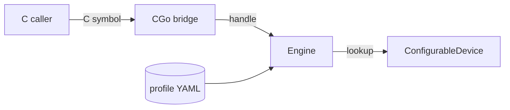

# 库与 Shims

要让未经修改的 NVIDIA 工具看到并不存在的硬件，只有两种办法：替换它加载的库，或拦截它读取的文件。Mokka 两者都做，因为它只能拥有其中之一。

| 工具请求的内容 | Mokka 的应答方式 | 手段 |
|---|---|---|
| NVML——`nvidia-smi`、DCGM、device plugin、DRA driver | 模拟的 `libnvidia-ml.so` | **替换** |
| PCI sysfs——`lspci`、拓扑感知调度器 | `libmockfs.so` | **拦截** |
| InfiniBand——`ibstat`、`ibv_devinfo`、`iblinkinfo` | `libibmock*` 库 | **拦截** |
| `nvidia-imex` 二进制 | `nvidia-imex-shim` | **exec 包装** |

## 为什么需要两种机制

NVML 是一个库，而库可以直接替换：Mokka 在消费者已经加载的路径上提供一个真实的 `libnvidia-ml.so`，并拥有整个契约。这里不转发任何调用——其后什么都没有。

`/sys` 和 `/dev` 不属于 Mokka——它们属于内核。假的目录树可以部署在磁盘上的别处，但 `lspci` 仍然会去看 `/sys/bus/pci`。因此 Mokka 改写了这些工具的*查找*行为，让它们在原本使用的路径上读到部署好的目录树。

调试时的实际结论：**`nvidia-smi` 输出错误指向库；`lspci` 或 `ibstat` 输出错误指向 shim。**

这些内容在整个系统中的位置，参见[架构概览](../architecture.md)。

## 模拟 NVML 库

一个真实的 `libnvidia-ml.so`，消费者可以像加载厂商库一样 `dlopen` 它——但它读取的是 YAML profile，而不是驱动和 GPU。

### 它在每个消费者内部运行，而不是作为服务

没有守护进程。每个加载该库的进程都拥有自己的引擎副本、自己的设备对象和自己的节点视图。同一节点上的两个消费者之所以保持一致，是因为它们读取同一份配置，而不是因为它们与某个共享对象通信。

这一事实解释了该组件的大部分行为——包括为什么运行时变更以文件而非命令的形式交付。

### 调用如何被应答



消费者调用一个 C 符号。桥接层跨越 CGo 边界转换参数，并把不透明的设备句柄解析为 Go 对象。该对象根据配置应答，返回值沿原路返回，在桥接层转换为 C 类型。

句柄是不透明指针，从 `nvmlInit` 到对应的 `nvmlShutdown` 期间有效。初始化是引用计数的，因此初始化两次的消费者必须关闭两次。最后一次关闭时句柄失效，其地址永不复用——陈旧句柄会被拒绝，而不是静默解析到另一台设备。

该库可安全地被多线程使用。

### 什么决定应答

两项输入，按固定顺序合并：

| 输入 | 何时变化 | 范围 |
|---|---|---|
| GPU profile | 安装或 `helm upgrade` 时 | 节点的静态身份：型号、数量、显存、拓扑 |
| 运行时覆盖 | 随时，无需重启 | 健康与遥测：温度、功耗、利用率、时钟、ECC 状态、故障模式 |

因为库是逐进程的，Mokka 无法把覆盖直接推送给它。覆盖写在 profile 旁边的一个文件中，每个已加载的副本按较短 TTL 重新读取，并合并到基础配置之上。运行中的和新启动的进程在一个间隔内收敛，profile 本身从不改动。参见[运行时控制](../nvml-mock-ctl.md)。

### 已实现与桩

NVML 很大，并非每个函数都有手写实现。那些没有实现的函数仍然**导出符号**并返回 `NVML_ERROR_NOT_SUPPORTED`。

这比听起来更重要。探测某个函数是否存在的消费者会得到诚实的"不支持"并走回退路径——与它面对较旧的真实驱动时的做法一样。缺少符号则会导致动态链接失败，消费者在加载时崩溃。

查看当前比例：

```bash
go run ./cmd/generate-bridge -input $GO_NVML_DIR/pkg/nvml/nvml.go --stats
```

桩层由 NVML 自身的头文件生成，因此添加手写实现会自动移除其桩。该工作流参见[贡献指南](../contributing/index.md)。

### 限制

该库应答管理类调用。它没有数据通路：什么都不计算，也不会在不存在的设备上分配内存。任何需要真实 GPU 去*做工作*而非*报告状态*的事情都超出范围。

目前不支持在 CPU 上模拟 CUDA。Mokka 不模拟的其他接口面，参见[尚未模拟的内容](../faq.md#what-is-not-simulated-yet)。

## Shims

### shim 何时有效，何时无效

两个 shim 是 `LD_PRELOAD` 库。它们拦截程序用于访问文件系统的 libc 包装函数——`open`、`stat`、`readlink`、`opendir` 等——并给匹配的路径拼上一个前缀。

这只对通过 libc 的程序有效。

!!! warning "Go 二进制完全绕过 `LD_PRELOAD`"
    Go 直接发起系统调用而不是通过 libc，因此永远不会查询预加载库。Kubernetes 控制面大部分是 Go，这也是 Mokka 还要把部署好的目录树绑定挂载到真实路径的原因。shim 服务于 C 工具；挂载服务于其他一切。

除非设置了相应的环境变量，否则两个库都是空操作，因此继承它们却没有相应配置的进程看到的是真实宿主机。

| Shim | 类型 | 让什么生效 |
|---|---|---|
| `libmockfs` | `LD_PRELOAD` | `lspci`、拓扑感知调度器和 Slurm 的 `AutoDetect=nvidia` 看到模拟 GPU |
| `libibmock` | `LD_PRELOAD` | `ibstat`、`ibstatus`、`iblinkinfo`、`ibv_devinfo` 看到模拟 InfiniBand HCA |
| `nvidia-imex-shim` | `execve` 包装器 | `nvidia-imex` 在没有 GPU 的机器上启动 |

### libmockfs

构建 `libmockfs.so`。它把 `/sys/bus/pci`、`/sys/devices/pci`、`/sys/module`、`/proc/modules` 和 `/proc/driver/nvidia` 下的查找重定向到 `MOCK_PCI_ROOT` 指定的目录树，未设置该变量时为空操作。两个 `/proc` 路径无法绑定挂载，因为 runc 拒绝在 `/proc` 内挂载，所以 `lsmod` 和 Slurm 的 GPU 自动检测只能通过这个 shim 到达模拟内容。

### libibmock

构建三个库，因此 InfiniBand 模拟可以分程度开启，而不是一次性全开：

| 库 | 覆盖范围 |
|---|---|
| `libibmocksys.so` | sysfs 和设备节点路径重定向 |
| `libibmockumad.so` | UMAD 管理接口 |
| `libibmockverbs.so` | libibverbs |

`MOCK_IB` 选择模拟 fabric 的程度。chart 将其暴露为 `infiniband.mockTier`：

| `MOCK_IB` | 效果 |
|---|---|
| `full` | 路径重定向加上 UMAD 和 verbs，由 `mock-ib` 守护进程支撑 |
| `sysfs` | 仅路径重定向——工具能枚举设备，但无法打开 verbs context |
| `off`、未设置或无法识别 | 所有 shim 都成为真正的空操作，进程看到真实宿主机 |

匹配不区分大小写，没有单独的禁用 flag：不设置 `MOCK_IB` 就是关闭 shim 的方式。重定向目标是 `MOCK_IB_ROOT`，chart 将其指向 `/var/lib/nvml-mock/ib`。

这些库面向 glibc 2.36 及更高版本。较旧的 `__xstat` 系列符号也会被拦截，使 shim 在更早的 libc 版本上仍然有效。

### nvidia-imex-shim

它不是 `LD_PRELOAD` 库，而是 nvml-mock 镜像中的一个小型 Go 程序。在多节点 NVLink profile（如 `gb200`）上，[节点守护进程](node-daemon.md)把它作为 `usr/bin/nvidia-imex` 部署到模拟驱动树中，与 NVIDIA 的守护进程并列——后者从固定版本的 IMEX 归档中部署为 `nvidia-imex.real`。NVIDIA DRA driver 像在真实节点上一样在那里找到 `nvidia-imex` 并挂载进它的 ComputeDomain daemon，[NRI 插件](nri-plugin.md)则把 `nvidia-imex.real` 加在旁边。

上游 compute-domain daemon 把命令行硬编码，没有 flag 透传，因此无法从外部注入 `--nogpu`。该 shim 会追加它，并 `exec` 自身目录下的 `nvidia-imex.real`，保留参数、环境和 stdio。因为它用 `exec` 而不是 fork，不会有包装进程滞留，信号直接到达守护进程。真正的守护进程随后以 NO GPU 模式运行，并与对等端使用真实的 IMEX 协议通信。IMEX 如何进入节点，参见 [ComputeDomain 指南](../guides/compute-domain/README.md#providing-imex)。

这个组件注定会消失：它只存在到上游支持传递额外参数为止（[#304](https://github.com/NVIDIA/k8s-test-infra/issues/304)）。

### 它们如何进入进程

chart 在节点守护进程上预加载全部四个库，最具体的在前：

```text
LD_PRELOAD=/usr/local/lib/libibmockumad.so.1:/usr/local/lib/libibmockverbs.so.1:\
/usr/local/lib/libibmocksys.so.1:/usr/local/lib/libmockfs.so.1
```

工作负载容器通过交付模拟内容其余部分的同一套 CDI 注入接收它们，因此获得模拟 GPU 的容器也会获得让 C 工具与之保持一致的 shim。

### 构建与测试

```bash
make mockfs-shim     # 构建 libmockfs.so
make test-mockfs     # 用真实 C 测试二进制进行集成测试
```

`libmockfs` 在 `testbin/` 下附带测试二进制，用于验证强化版 `open` 和 `fopen` 变体，因为 glibc 的 `_FORTIFY_SOURCE` 会重写这些调用点，只 hook 普通符号的 shim 会静默漏掉它们。

## 相关链接

| 想了解 | 参见 |
|---|---|
| 整个系统如何组合 | [架构](../architecture.md) |
| 把这一切部署到节点上的是什么 | [节点守护进程](node-daemon.md) |
| 每个 profile 配置项 | [配置参考](../configuration.md) |
| 运行时修改状态 | [运行时控制](../nvml-mock-ctl.md) |
| 开关 InfiniBand 模拟 | [安装](../helm-chart.md#infiniband-mocking) |
| 添加 NVML 函数或 profile | [贡献指南](../contributing/index.md) |
