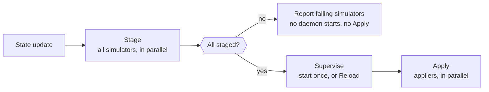

# 节点守护进程

让一个节点看起来拥有 GPU 的组件。它在每个目标节点上作为 DaemonSet 的主容器运行一个实例，消费者之后读取的一切——驱动文件、设备节点、PCI 树、CDI 规格、InfiniBand 设备——都由这个进程放置。

它是电平触发的协调器，而不是一次性安装器：它从 GPU profile 编译出期望状态，让节点向该状态收敛，并在 profile 变化时重复这一过程。

!!! note "它仍以 `node-agent` 名称交付"
    容器、其二进制和 `nodeAgent` chart 取值块目前仍都叫 `node-agent`，因此 `kubectl` 和 `values.yaml` 中显示的是这个名字。改名为 *daemon* 的工作正在进行中。

它在整个系统中的位置，参见[架构概览](../architecture.md)。

## 模拟器

守护进程本身不拥有任何模拟逻辑。每个接口面都是一个**模拟器**，守护进程的职责是按正确顺序运行它们，并监管那些比一次协调存活更久的模拟器。

| 模拟器 | 阶段内容 |
|---|---|
| `gpudriver` | 字符设备、模拟 NVML 库、[`nvidia-smi`](#which-nvidia-smi-a-node-runs)、procfs 条目、引擎配置，以及把驱动树绑定挂载到 `/run/nvidia/driver`（GPU Operator 期望的路径） |
| `pcibus` | 假的 `/sys/bus/pci/devices` 树、`libmockfs.so` shim，以及让 Node Feature Discovery 为节点打标签的 NFD feature 文件 |
| `cri` | 两个 CDI 规格，供 containerd 把模拟 GPU 注入工作负载容器；以及注册 `nvidia` handler 的[容器运行时设置](#container-runtime-setup)。IMEX 部署期间，GPU 规格还会挂载 `nvidia-imex` 和 `nvidia-imex-ctl`，就像 NVIDIA Container Toolkit 在真实 GB200 或 GB300 节点上所做的那样，`nvidia-imex.real` 与 Mokka 的 `nvidia-imex` shim 并列 |
| `imex` | 在多节点 NVLink profile 上：IMEX 通道字符设备、`/proc/devices` 覆盖层、DRA compute-domain 插件读取的能力文件，以及来自固定版本归档的 `nvidia-imex` 和 `nvidia-imex-ctl`：由 chart 的 `imex.binaries.image` 提供，或在 `IMEXDownload` [特性门控](../feature-gates.md)开启时从 NVIDIA 下载到节点缓存。没有归档的节点保持就绪且不部署 IMEX，就像没有 IMEX 包的真实节点 |
| `nvlink` | ComputeDomain 拓扑文档，赋予节点 NVLink fabric 身份。部署在覆盖层中供 NRI 注入的容器使用，也放在驱动树的 `config.yaml` 旁边，供只挂载驱动根目录的进程（如 DRA driver 的 kubelet 插件）中的模拟库找到 |
| `fabricmanager` | `nv-fabricmanager` 的替代物；在真实 NVSwitch 平台上，它必须先注册 GPU，GPU 才可用 |
| `ib` | 假的 `/sys/class/infiniband` 树、IB shim 和 CLI 工具，以及提供 UMAD 和 verbs 的 `mock-ib` 守护进程 |
| `kernellog` | 像驱动的 printk 一样，把注入的 Xid 发布到节点内核日志 |

### 节点运行哪个 nvidia-smi

真实节点的 `nvidia-smi` 随其驱动一起提供，来自其他分支的二进制会误读驱动的应答：NVML 曾以不同方式为某些字段值编号，例如从 615 起按每 GPU 36 条 NVLink 寻址，而 580 按 18 条。因此镜像为每个驱动分支各提供一个 `nvidia-smi`——580.65.06 和 615.71.09，`gpudriver` 根据 profile 的 `system.driver_version`（或 chart 的 `driverVersion`）部署其中一个：

- 在驱动所属分支内，选择不新于该驱动的最新二进制，或当所有二进制都更新时选择该分支最旧的：其他分支的二进制可能寻址不同数量的 NVLink。
- 没有本分支二进制的驱动，会获得更旧分支中最新的一个，绝不会是更新的分支：NVML 只为针对更旧驱动构建的调用方提供服务。

在节点守护进程的 Pod 中运行 `nvidia-smi`，运行的就是这个部署好的副本。

| Profile 驱动 | `nvidia-smi` |
|---|---|
| 615 及之后 | 615.71.09 |
| 580 到 614 | 580.65.06 |
| 580 之前 | 580.65.06，随附的最旧版本 |

还有一种配对仍有问题：580.95 到 614 的驱动以较新的方式为时钟事件计数字段编号，580.65.06 二进制无法读取，因此显示为 `N/A`。没有自带 profile 使用这样的驱动。

这些二进制来自 NVIDIA 的 CUDA 仓库（580）和 Canonical 的 Ubuntu 归档（615，由 NVIDIA 驱动安装器重新打包），并在 `deployments/nvml-mock/Dockerfile` 中固定版本。615 包会校验其固定校验和，因此任何来源都可以：Launchpad、Ubuntu 归档，或添加到 `NVIDIA_SMI_615_URLS` 构建参数的来源。`make nvidia-smi-smoke` 无需集群即可用模拟 NVML 运行每一个。

## 协调生命周期

模拟器实现一个必需接口和至多两个可选接口。它实现了哪些，决定守护进程何时调用它。

| 接口 | 实现者 | 用途 |
|---|---|---|
| `Simulator` | 全部八个 | `Stage` 写入尚不对外可见的产物。幂等，每次状态变化都重新运行 |
| `Applier` | `gpudriver`、`pcibus`、`cri` | `Apply` 发布节点*外部*某方会响应的产物——containerd、NFD、GPU Operator validator |
| `Daemon` | `fabricmanager`、`ib`、`kernellog` | `Run` 监管一个长驻进程；`Reload` 不重启就把后续状态交给它 |

一次协调分三波运行：



`Stage` 与 `Apply` 的分离是关键。部署是私有的：文件存在，但节点外还没有任何东西在看它们。发布才让它们对 containerd、NFD 和 operator 成为真实存在。分开两者意味着节点绝不会处于半可见状态——要么所有接口面都部署然后一起发布，要么什么都不发布。

两波对故障的处理刻意不同：

- **Stage 收集所有错误。** 一次协调会报告所有失败的模拟器，而不只是第一个，因此一趟就能告诉你全部问题。
- **Apply 快速失败。** 各 applier 相互依赖——CDI 规格引用 `gpudriver` 必须已部署的字符设备——因此越过第一次失败继续会发布不连贯的内容。

**守护进程只启动一次**，在第一次成功通过屏障时。守护进程拥有 socket 或端口，第二个实例会争抢而不是与其收敛。后续状态通过 `Reload` 到达运行中的守护进程，这就是修改 profile 不需要重启 Pod 的原因。

## 健康

两个探针都在 9091 端口上提供服务，回答不同的问题：

| 探针 | 通过条件 | 报告内容 |
|---|---|---|
| `/healthz` | 最近一次 `Stage` 波次无错完成 | 哪些模拟器失败、何时失败。下一次成功 `Stage` 后恢复 |
| `/readyz` | 每个模拟器都报告就绪 | 哪个模拟器没有在服务 |

两者都不查询状态来源。存活性反映的是部署做了什么，而不是能否获取新状态——因此不可达的来源会让节点继续服务已部署的内容，而不是触发全机群重启。

## 期望状态来自哪里

**状态来源**向守护进程提供输入。目前只交付了一种实现：一个文件来源，监视 profile 和拓扑文档，任一变化时发出更新。

它通过文件系统事件监视所在的*目录*而不是文件。ConfigMap 更新和编辑器保存都会替换文件的 inode——kubelet 通过重命名原子的 `..data` 符号链接做到这一点——因此只监视文件本身会一直盯着刚被替换掉的那个。对于通过符号链接到达的路径，两端都会受到监视，因此 `/etc/mokka/config.yaml` 背后的修改也能到达。

`--resync-interval` 会不管事件如何都重新读取两个文档，覆盖内核不报告事件的情况：NFS 上的 profile，或达到 inotify 监视上限的主机。

控制面来源是为 [MEP-0001](https://github.com/NVIDIA/k8s-test-infra/tree/main/enhancements/meps/0001-mokka-control-plane) 准备的桩，它会让集群级组件而不是 ConfigMap 驱动节点状态。它尚未实现；文件来源是目前唯一在用的路径。

## 容器运行时设置

`cri` 模拟器还会为这些规格准备节点的容器运行时，正如 [MEP-0006](https://github.com/NVIDIA/k8s-test-infra/tree/main/enhancements/meps/0006-automatic-cdi-setup) 所述。它默认开启（`nodeAgent.containerRuntime.enabled`），目前只支持 containerd。

模拟器安装镜像中随附的 NVIDIA Container Toolkit 版本。该版本自带的 `nvidia-ctk` 随后把 toolkit 的运行时以 `nvidia` handler 注册到 containerd，采用 CDI 模式，并设为默认 handler：

```text
nvidia-ctk runtime configure --runtime=containerd --config-source=file \
  --config=/etc/containerd/config.toml \
  --drop-in-config=/etc/containerd/conf.d/50-mokka.toml \
  --nvidia-runtime-name=nvidia \
  --nvidia-runtime-path=/usr/bin/nvidia-container-runtime \
  --nvidia-set-as-default \
  --cdi.enabled
```

[NRI 插件](nri-plugin.md)开启时（默认如此），模拟器随后在同一文件中打开 NRI，指向插件的 socket（`nri.socketPath`）：containerd 1.7 出厂时 NRI 是关闭的，而 `nvidia-ctk` 没有相关设置。2.1 之前的 containerd 从导入文件获取插件的整个表，因此只要该文件存在，NRI 的其他设置就是 containerd 默认值。

| 节点上的路径 | 内容 |
|---|---|
| `/usr/local/nvml-mock/toolkit/` | 镜像中 toolkit 版本的 `nvidia-container-runtime`、`nvidia-ctk` 和 `nvidia-cdi-hook`，以及运行时的 `config.toml` |
| `/usr/bin/nvidia-container-runtime`、`nvidia-ctk`、`nvidia-cdi-hook` | 指向 toolkit 目录的链接，包安装就是把二进制放在那里 |
| `/etc/nvidia-container-runtime/config.toml` | 指向运行时配置的链接：CDI 模式，默认种类 `nvidia.com/gpu` |
| `/etc/containerd/conf.d/50-mokka.toml` | `nvidia-ctk` 写入的 Mokka 配置文件：`nvidia` handler 为默认，`enable_cdi = true`。NRI 插件开启时，NRI 表紧随其后 |
| `/etc/containerd/config.toml` 中的 `imports` | `conf.d/*.toml` glob，没有条目覆盖它时由 `nvidia-ctk` 添加。`nvidia-ctk` 每次运行都会重写该文件，因此其中的注释会丢失 |

containerd 的配置目录（Mokka 配置文件所在处）是 `nodeAgent.containerRuntime.containerd.configDir`，未设置时为 `/etc/containerd/conf.d`。

随后节点上的每个容器都在 NVIDIA 运行时下运行。`NVIDIA_VISIBLE_DEVICES` 指定了 GPU 的容器（device plugin 会这样设置）会获得这些 GPU 的模拟驱动；没有该变量的容器则像在 `runc` 下一样运行。指定 `runtimeClassName: nvidia` 的 Pod（GPU Operator 自己的 Pod 就是这样）获得同一 handler。撤销操作会随 Mokka 配置文件一起移除默认设置，于是节点回到自己的默认 handler。

toolkit 的传统安装方式和 EKS 加速 AMI 以同样方式配置节点。启用 CDI 的 GPU Operator 则保持 `runc` 为默认，通过 containerd 自身的 CDI 支持服务工作负载，这在 Mokka 节点上同样有效。

**containerd 重启时。** 当 Mokka 配置文件发生变化，以及节点 Pod 启动时一次，Apply 会通过宿主机的 systemd 重启 containerd。为此节点 Pod 运行在宿主机 PID 命名空间中，因为 systemctl 拒绝与看不见的 systemd 通信。如果 containerd 没有回来，节点 Pod 不就绪，其日志中有错误；节点上的 `journalctl -u containerd` 会说明原因。在 containerd 重新运行之前，该节点上不会启动新容器：按下面的方法手工删除 Mokka 配置文件，即可在没有该 handler 的情况下恢复。设置 `restartMode: none` 时，文件会被写入，节点 Pod 保持就绪，日志说明重启待处理；Pod 则保留自己的 PID 命名空间。

**它不碰的节点。** 宿主机 `PATH` 上没有 `containerd` 的节点，运行的是其他运行时（如 CRI-O），或是 k3s 和 rke2 内嵌的 containerd：模拟器不安装任何东西，只记录警告。如果某个包安装路径上存在模拟器没有链接的 toolkit 文件，说明另有安装器准备过该节点：它不安装任何东西，也不改动 containerd。两种情况下节点 Pod 都保持就绪，日志会说明原因。

**节点 Pod 停止时。** Revoke 删除 Mokka 的配置文件并排队一次 containerd 重启，systemd 会在 Pod 消失后完成。`helm uninstall` 因此在 containerd 中不留 Mokka handler，而一次滚动发布会在每个节点上重启 containerd 两次：旧 Pod 停止时一次，新 Pod 配置时一次。开启配置时，chart 拒绝带 `maxSurge` 的滚动发布，因为旧 Pod 的撤销会移除新 Pod 的设置。二进制会保留，因为通过该 handler 创建的容器会调用运行时执行 `exec`、`kill` 和 `delete`。

**GPU Operator。** 安装时请设置 `toolkit.enabled=false`。operator 的 toolkit 无法在没有 NVIDIA 内核模块的节点上运行，而这个模拟器完成了它的工作。

**要求。** containerd 1.7 或更新、systemd 或 `restartMode: none`，以及节点上 `/usr/bin`、`/usr/local` 和 `/etc` 可写。若 containerd 在运行但节点无法配置，例如 Bottlerocket 或只读 `/usr`，请设置 `nodeAgent.containerRuntime.enabled=false`。

**手工移除。** 在被杀死前来不及执行 Revoke 的节点 Pod 会留下配置。在节点上：

```bash
rm -f /etc/containerd/conf.d/50-mokka.toml
systemctl restart containerd
# 当不再有容器运行在 nvidia handler 下时：
rm -f /usr/bin/nvidia-container-runtime /usr/bin/nvidia-ctk /usr/bin/nvidia-cdi-hook \
  /etc/nvidia-container-runtime/config.toml
rm -rf /usr/local/nvml-mock
```

Revoke 会保留 `nvidia-ctk` 添加到 `imports` 中的 `conf.d/*.toml` 条目，目录为空时它不加载任何东西；如果你愿意，也可以从 `config.toml` 中移除它。

## 关闭

拆除是协调的逆过程，即便守护进程因故障退出也会运行：

1. 对每个 applier 执行 **Revoke**——停止发布，使节点外没有任何东西继续对被移除的产物采取行动。
2. 对每个模拟器执行 **Discard**——删除部署好的产物。

两波并发且尽力执行：一个模拟器拆除失败不会阻止其他模拟器清理。`cri` 模拟器的 Revoke 还会撤销[容器运行时设置](#container-runtime-setup)。拆除 context 比守护进程自身 context 的取消更持久，因此被删除的 Pod 仍有机会让节点恢复原状。

## 相关链接

| 想了解 | 参见 |
|---|---|
| 整个系统如何组合 | [架构](../architecture.md) |
| 守护进程部署的库与 shim | [库与 Shims](libraries-and-shims.md) |
| 守护进程编译的每个 profile 配置项 | [配置参考](../configuration.md) |
| 无需重新部署即可修改模拟状态 | [运行时控制](../nvml-mock-ctl.md) |
