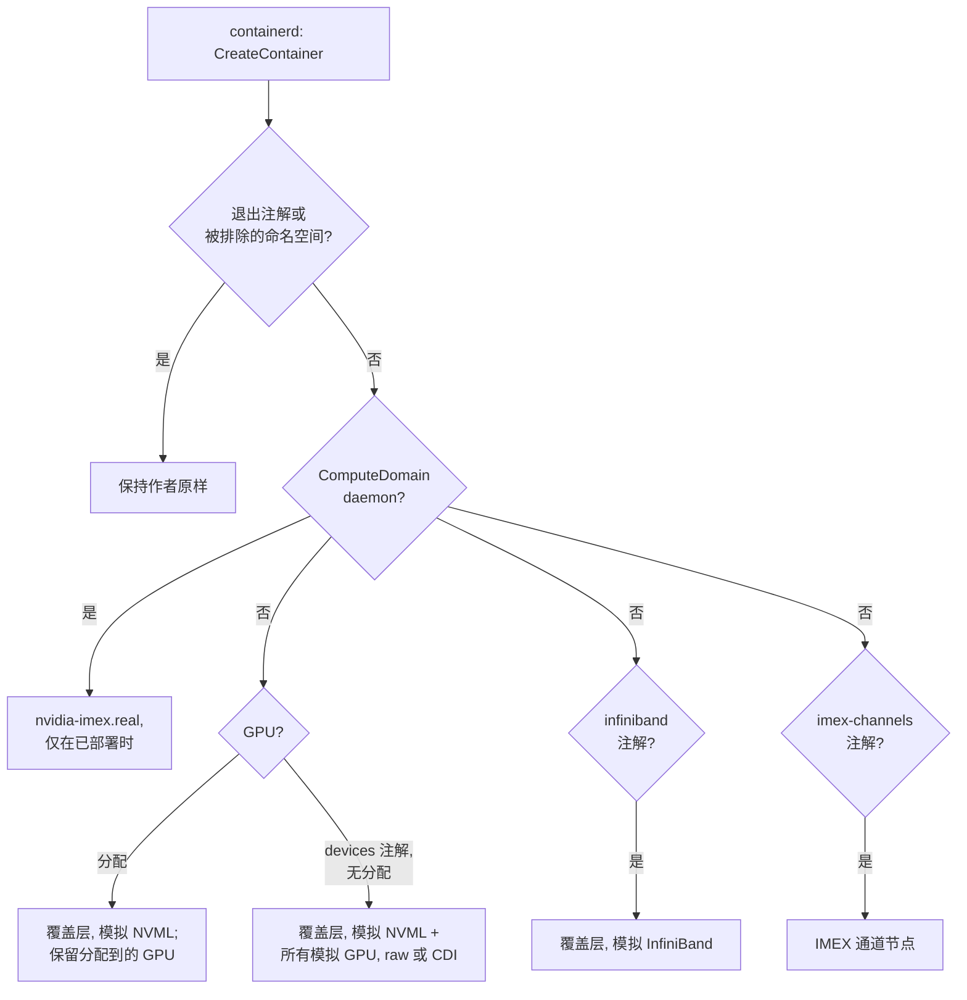

# NRI 插件

把模拟 GPU 放进 Pod 作者从未改动过的容器里的组件。

[节点守护进程](node-daemon.md)在宿主机上部署了一棵 GPU 目录树，但容器只能看到其运行时给它的东西。没有帮助时，工作负载需要针对 Mokka 修改 Pod spec——一个 `hostPath` 挂载、一些 `MOCK_*` 环境变量。NRI 插件消除了这一步：它向 containerd 的节点资源接口（NRI）注册，在容器创建时编辑容器，于是以常规方式获得 GPU 分配的工作负载无需改动就能带着模拟驱动启动。

!!! note "什么是 NRI"
    **节点资源接口（Node Resource Interface）**是把扩展插入 OCI 兼容容器运行时的框架。插件向运行时注册，在容器创建时得到通知，并可在容器启动前对其 OCI spec 做有限调整——挂载、设备、环境变量。

    它位于容器运行时接口（CRI）*之下*，因此是运行时特性而非 Kubernetes API：Kubernetes API 中没有 NRI 对象，kubernetes.io 上也没有相关描述。需要 containerd 1.7 或更新版本。参见 [NRI 项目](https://github.com/containerd/nri)和[containerd 的 NRI 文档](https://github.com/containerd/containerd/blob/main/docs/NRI.md)。

它在整个系统中的位置参见[架构概览](../architecture.md)。

## 哪些容器会被注入

插件只注入那些被给予了 GPU 或明确请求了模拟接口面的容器。节点上其他一切保持作者原本的写法，就像真实 GPU 节点不会给未请求 GPU 的 Pod 任何东西。

它做三项彼此独立的选择——GPU、InfiniBand 和 IMEX——只添加被选中的接口面，三者互不连带。

| 容器 | 获得 |
|---|---|
| 持有来自 device plugin 或 NVIDIA DRA driver 的 GPU 分配 | 模拟 NVML 生效的覆盖层。分配到的 GPU 保持调度器所指派的原样 |
| Pod 带注解 `nvml-mock.nvidia.com/devices: "true"`，无分配 | 模拟 NVML 生效的覆盖层，以及节点上所有模拟 GPU |
| Pod 带注解 `nvml-mock.nvidia.com/infiniband: "true"` | 模拟 InfiniBand 工具生效的覆盖层 |
| Pod 带注解 `nvml-mock.nvidia.com/imex-channels: "true"` | 模拟 IMEX 通道节点，别无其他 |
| 位于带 `resource.nvidia.com/computeDomain` 标签的 Pod 中的 DRA driver `compute-domain-daemon` 容器 | `nvidia-imex.real`，仅在已部署时，别无其他 |
| 其他 | 无 |

匹配多行的容器会获得各自所有的接口面，但 ComputeDomain daemon 例外，它只获得属于自己那一行的内容。

DRA driver 通过自身的 CDI 编辑交付 daemon 的驱动脚印，包括 `nvidia-imex`，因此插件只补上模拟节点额外需要的东西：Mokka 的 `nvidia-imex` shim，以及在它旁边运行的真正 IMEX daemon。没有已部署的 IMEX 时，daemon 会像在没有 IMEX 包的真实节点上一样失败；插件从不拒绝容器。

**覆盖层**是挂载在 `/opt/nvml-mock` 的模拟驱动树，加上指向它的 `PATH`、`LD_LIBRARY_PATH` 和 `LD_PRELOAD` shim。GPU 和 InfiniBand 选择共享它，因为 InfiniBand 工具和 shim 与模拟驱动一起部署。环境变量只打开被选中的部分：

| 选中 | 环境变量 |
|---|---|
| GPU | `MOCK_NVML_CONFIG`、`MOCK_PCI_ROOT`、`GFD_MACHINE_TYPE_FILE`，以及已部署时的 ComputeDomain 拓扑 |
| GPU 而非 InfiniBand | `MOCK_IB=off`，使预加载的 InfiniBand shim 什么也不做 |
| InfiniBand | `MOCK_IB=full`、`MOCK_IB_ROOT` 和 `MOCK_IB_PING_SOCKET` |
| InfiniBand 而非 GPU | `MOCK_NVML_VISIBLE_DEVICES=none`，使部署好的 `nvidia-smi` 不报告任何 GPU |

当容器已经设置了其中之一时，它自己的值胜出，但 `MOCK_IB=off` 和 `MOCK_NVML_VISIBLE_DEVICES=none` 例外：决定容器获得什么的是注解，而不是镜像里烘焙的环境变量。

失去 `MOCK_NVML_CONFIG` 的进程——例如 Slurm 作业，它继承运行 `srun` 者的环境——仍会从覆盖层挂载中加载节点 profile；参见[库如何找到配置](../configuration.md#environment-variables)。shim 的变量没有这种回退，因此该进程中不会加载 `libmockfs.so`。

`devices` 注解是管理路径：它给 Pod 整个节点，例如监控 agent，而不经过调度器记账。与其他注解一样，它作用于 Pod 中的所有容器。

!!! note "特权 Pod 与 `NVIDIA_VISIBLE_DEVICES`"
    在真实 GPU 节点上，未请求 GPU 的特权容器能看到所有 GPU，设置了 `NVIDIA_VISIBLE_DEVICES=all` 的容器在 NVIDIA 容器运行时处理时也是如此。插件这两者都不注入：继承的设备节点不构成分配证据，插件也无法判断哪个运行时在处理容器。在节点运行 NVIDIA 容器运行时的地方，该运行时仍会对该变量起作用。否则，请给这样的 Pod 加上 `devices` 注解。

## 容器发生了什么

调整按固定顺序执行，任何一步都不能失败：

没有任何分支选中任何内容时，容器保持作者原样。

### 容器何时不被触碰

以下任一情况都会让容器保持作者原样：

- Pod 带有 `nvml-mock.nvidia.com/inject: "false"`；
- 其命名空间在排除列表中；
- 它既没有 GPU 分配，也没有 `devices`、`infiniband` 和 `imex-channels` 注解中的任何一个；
- 它已在目标路径挂载了覆盖层。

最后一项检查让重复调整变得安全。已经带有覆盖层的容器此前已经过这里，重跑会重复应用。

## 识别 GPU 分配

kubelet 在运行时请求本插件调整容器之前，会应用 device plugin 或 DRA driver 的分配，因此分配在传入的容器 spec 中可见。只有以下内容算作证据：

| 证据 | 产生者 |
|---|---|
| 一个带编号的 `/dev/nvidiaN` 字符设备**并且**有一条恰好允许该设备的 cgroup 规则 | 使用 `--pass-device-specs=true` 的 device plugin |
| 一个 CDI 设备 `k8s.device-plugin.nvidia.com/gpu=<id>` | 采用 `cdi-cri` 设备列表策略的 device plugin；`<id>` 是 GPU UUID，或使用 `--device-id-strategy=index` 时的索引 |
| 一个 CDI 设备 `k8s.gpu.nvidia.com/claim=<id>` | NVIDIA DRA driver |

规则很严格，因此容器永远不会被误认为已分配：

- 特权容器在通配 cgroup 规则下继承所有宿主机设备。它的 `/dev/nvidiaN` 节点不是被分配的，因此不算。
- `/dev/nvidiactl` 或 `/dev/nvidia-uvm` 之类的控制设备伴随分配出现，但不标识 GPU。
- 其他 CDI 种类不算。包括 device plugin 的 `k8s.device-plugin.nvidia.com/gdrcopy=all` 和 `…/mofed=all`——它们随每次分配而来——容器工具链的 `nvidia.com/gpu`，以及 Mokka 自己的 `nvml-mock.nvidia.com/gpu=all`。

分配始终优先于 `devices` 注解：容器精确保留分配给它的 GPU，`nvidia-smi` 报告的是该子集而非整个节点。这是 [MEP-0002](https://github.com/NVIDIA/k8s-test-infra/tree/main/enhancements/meps/0002-device-plugin-nri-composition) 的规则：调度器分配的内容永不被扩大。

!!! warning "device plugin 必须留下分配证据"
    只设置 `NVIDIA_VISIBLE_DEVICES`（默认的 `envvar` 策略）或只通过 Pod 注解交付 CDI 设备（`cdi-annotations`）的 device plugin，不会在容器 spec 中留下证据。它的 Pod 会被视为未分配，什么也得不到。请使用 `--pass-device-specs=true` 运行 device plugin，如[device plugin 指南](../guides/device-plugin.md)所示，或使用 `cdi-cri` 策略，即 GPU Operator 启用 CDI 时的做法。

!!! note "IMEX 不在此规则之内"
    IMEX 通道由自己的注解请求，永不被抑制。该注解是为不声明通道的容器准备的：ComputeDomain 的工作负载通过其 DRA claim 获得通道，无需注解。

## 选择 InfiniBand

只有 `infiniband` 注解会选择 InfiniBand。特权容器在通配 cgroup 规则下继承所有宿主机 `/dev/infiniband/*` 节点，而无需请求 RDMA，因此设备路径不构成证据。插件目前还不识别来自 RDMA device plugin 或 DRA driver 的分配；那需要一种继承节点无法产生的信号，而目前还没有经过验证的信号。

该注解从不添加或移除真实的 `/dev/infiniband/*` 节点。它把 InfiniBand 工具指向节点 agent 渲染的模拟 sysfs 树。在没有 InfiniBand 的 profile 上，该树中没有 HCA：Pod 仍会启动，其工具什么也找不到，插件会记录一条警告。

## 设备注入模式

当插件把 GPU 交付给带 `devices` 注解但没有分配的 Pod 时，`deviceInjectionMode` 选择机制。它只改变*方式*，不改变*是否*，且从不触碰已分配的容器。

| 模式 | 交付内容 | 适用场景 |
|---|---|---|
| `raw`（默认） | 模拟 `/dev/nvidiaN` 节点，直接放入调整中 | 始终可用。MEP-0002 要求保持可达性，也是 CDI 关闭或不存在时唯一可用的模式 |
| `cdi` | 运行时从 `cri` 模拟器写下的规格中解析的 CDI 设备引用 | containerd 2.1 或更新，或 1.7.30 或更新。containerd 2.0.x 会无错误地丢掉通过 NRI 请求的 CDI 设备，因此容器启动时没有 GPU |

未知值会被拒绝而不是强制转换。拼写错误若静默回退到 `raw`，看起来会与正常工作的 CDI 部署完全一样，而区别只能在已运行 Pod 的 OCI spec 中看到。

## 注解

| 注解 | 效果 |
|---|---|
| `nvml-mock.nvidia.com/inject: "false"` | 完全退出调整 |
| `nvml-mock.nvidia.com/devices: "true"` | 无分配时：获得覆盖层和所有模拟 GPU。有分配时：无效果 |
| `nvml-mock.nvidia.com/infiniband: "true"` | 获得模拟 InfiniBand 工具生效的覆盖层。不添加 GPU |
| `nvml-mock.nvidia.com/imex-channels: "true"` | 获得模拟 IMEX 通道。不添加覆盖层，也不添加 GPU |

## Fail-open

每一步都会降级而非阻塞。

每次调整前，插件检查其 Pod 内的节点 agent。它取得 staging 锁的共享端——agent 在部署或拆除驱动树时独占该锁——并询问 agent 的 `/stagedz` 端点目录树是否已部署。`/stagedz` 只跟随 agent 的 Stage 波次，因此失败的 Apply（如 NFD feature 文件写入失败）不会关闭它。在 `cdi` 模式下，Stage 还会撤回插件的 CDI 规格，直到 Apply 重新发布，因此这期间创建的容器会从新目录树获得原始设备节点，而不是一个命名了较小 profile 已移除节点的规格。当 agent 正在重启、重新部署或尚未部署时，插件保持容器不变，记录一条点名其命名空间、Pod 和容器的警告，并让 `/readyz` 因该原因失败。插件本来就会跳过的容器，例如被排除命名空间中的，不会被报告。

ComputeDomain daemon 跳过该检查。它只在 `nvidia-imex.real` 已部署时获得该文件，而 agent 最后发布它、最先撤回它。未被修改的 daemon 会一直运行而没有 `nvidia-imex.real`，直到 DRA driver 的启动探针重启它。

锁文件位于一个内存支持的 `emptyDir` 中，只挂载到节点 agent 和插件，因此没有工作负载能持有它而阻塞部署。它覆盖的是插件的*决定*，而不是运行时应用该决定，因此期间开始的拆除仍可能与一个容器竞态。在 Pod 终止期间，agent 最多等待其关闭超时的一半来获取锁，然后不带锁拆除。

即使 agent 正在服务，个别缺失的设备接口面仍可能把注入缩减为仅覆盖层，而不是阻塞容器创建。

另一种选择会更糟：一个在接口面缺失时报错的插件会阻塞节点上所有容器，包括本应创建该接口面的 daemon。

这个选择有一个值得了解的后果。**被 containerd 注销的插件会继续存活并静默停止注入**——什么都不会崩溃，Pod 只是悄悄在没有 GPU 的情况下启动。因此插件报告的是注入是否真的在发生，而不仅仅是进程是否在运行。

它还会监视卡住的请求。如果一次进行中的调整超过了 containerd 告诉插件它正在应用的超时，运行时已经放弃该请求，容器是在没有注入的情况下创建的。阈值是运行时自身超时的倍数，因此单个慢请求不会触发重启，但真正卡住的插件会被替换。

## 挂载传播

覆盖层以两个 bind 挂载抵达：驱动树只读，其 `config` 目录以可写方式覆盖其上，因为 `nvidia-smi --gpu-reset` 会写入那里。两者都是 `rprivate`，即没有 `mountPropagation` 的 `hostPath` 卷所获得的传播方式。

带有 `Bidirectional` 卷的容器，例如 DRA kubelet plugin，具有共享根目录。没有该选项时，可写 bind 会被复制到节点上的 `/var/lib/nvml-mock/driver/config`，每有一个这样的容器就翻倍，并在 Pod 消失后留存。`rslave` 也能阻止这一点，但 containerd 只在持有覆盖层的节点挂载是 shared 或 slave 时才接受它，否则容器创建失败。对于已经有副本的节点，参见[排障](../troubleshooting.md#mounts-pile-up-on-a-node-with-nri-enabled)。

## 代码如何划分

| 包 | 角色 |
|---|---|
| `internal/nri` | 与运行时耦合的一半：向 containerd 注册、转换其容器类型、报告健康 |
| `internal/nri/inject` | 决策：向容器添加什么。没有 containerd 类型跨越此边界，因此上述每条规则都能作为普通表驱动测试来验证 |

## 相关链接

| 想了解 | 参见 |
|---|---|
| 整个系统如何组合 | [架构](../architecture.md) |
| 是什么部署了本插件挂载的目录树 | [节点守护进程](node-daemon.md) |
| 其 chart 取值 | [安装](../helm-chart.md) |
| 检查它是否注入 | [配置 NRI 注入](../guides/nri-injection.md) |
