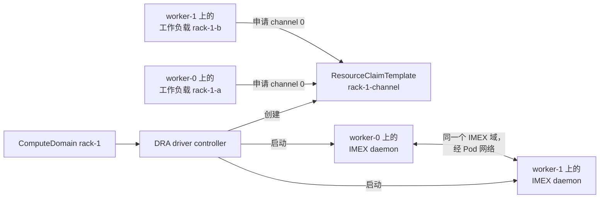

# 用 NVIDIA DRA Driver 运行 ComputeDomains

在一台 GPU 都没有的 Kind 集群上，用未经修改的 NVIDIA DRA driver，在模拟的 GB200 机柜上跑通 ComputeDomains。

**ComputeDomain** 是 NVIDIA DRA driver 中的一种资源，用来描述一组分布在不同节点上、通过多节点 NVLink 交换网共享显存的 Pod（例如一个 GB200 NVL72 机柜）。针对每个 ComputeDomain，driver 会在该域的工作负载所落到的每个节点上启动一个 IMEX（Internode Memory Exchange）daemon。同一个 NVLink **clique**（一张 NVLink 交换网连通的节点集合）里的 daemon 会组成同一个 IMEX 域；每个工作负载则拿到一个 **IMEX channel**，也就是授权它在该域内共享显存的设备节点。

driver（chart `0.5.0`）跑的是原版上游镜像，没有任何改动。Mokka 负责给每个节点补上真实 GB200 节点该有的东西：

- **NVLink 交换网身份。** 模拟的 NVML 库会对 `nvmlDeviceGetGpuFabricInfo` 和 `nvmlDeviceGetGpuFabricInfoV` 返回 cluster UUID、clique ID 和注册状态，取值来自 chart `topology` 配置里给该节点分配的集群级拓扑。driver 的 kubelet plugin 就是从这里读取每个节点的 clique。
- **IMEX 内核接口。** 一份替代 `/proc/devices`（含 `nvidia-caps-imex-channels` 主设备号）、`fabric-imex-mgmt` capability 文件和 `channel0` 设备节点——和真实驱动以 `NVreg_CreateImexChannel0=1` 加载时创建出来的东西一致。
- **IMEX 节点软件。** `nvidia-imex` 与 `nvidia-imex-ctl`，取自 Mokka 固定版本的 NVIDIA 归档包，放在模拟驱动目录里 driver 会去找的位置。Mokka 的 `nvidia-imex` 是一层垫片，它会以 NO GPU 模式启动真正的 daemon `nvidia-imex.real`，于是各 daemon 能在 Pod 网络上用真实的 IMEX 协议通信。参见[提供 IMEX](#providing-imex)。



这里没有真的共享显存，也没有 NVLink 流量：本指南验证的是**控制面**——调度、claim、daemon 生命周期、IMEX 域组建与就绪判断——而不是数据面。

## 前置条件

本指南会按 [`tests/e2e/kind-compute-domain-racks.yaml`](https://github.com/NVIDIA/k8s-test-infra/blob/main/tests/e2e/kind-compute-domain-racks.yaml) 创建自己的 Kind 集群：4 个 worker，分属 2 个机柜。集群凭据单独存一份 kubeconfig，不会使用你当前的 kubectl context。

| 工具 | 版本 | 用途 |
|---|---|---|
| `docker` | 24+，带 `buildx` | Kind 节点，以及构建 nvml-mock 和 IMEX binaries 镜像 |
| `kind` | v0.31+ | 创建集群，使用 Makefile 固定的 Kubernetes 1.35 节点镜像 |
| `kubectl` | v1.30+ | 等待和检查集群状态 |
| `helm` | 3.8+ | 从本地检出安装 nvml-mock，从 NVIDIA Helm 仓库安装 DRA driver |
| `go` | `go.mod` 里指定的版本 | `make imex-binaries-image`，负责下载并校验 IMEX 归档包 |
| `make` | 任意版本 | `make imex-binaries-image` |
| `bash` | 3.2+ | `run.sh` |

ComputeDomains 依赖 nvml-mock 的 NRI 插件（`nri.enabled`，默认开启），由它把真正的 `nvidia-imex` 交给 driver 的 IMEX daemon；本指南保持它开启。

首次运行需要联网：从 `developer.download.nvidia.com` 下载 IMEX 归档包，从 `helm.ngc.nvidia.com` 拉 DRA driver chart，并拉取 driver 和工作负载镜像。

第一次接触 Mokka？先跑一遍[快速入门](../../quickstart.md)看看模拟 GPU 是什么样，再来做这个演示会更快上手。

## run.sh 会做什么

1. 创建 Kind 集群 `mokka-compute-domain`；若已有集群且 4 个 worker 带着两机柜标签，就复用它。它把集群凭据写到 `~/.kube/mokka-compute-domain.kubeconfig`，之后每一次 `kubectl` / `helm` 调用都会显式指定这个文件和 `kind-mokka-compute-domain` context。
2. 构建 `nvml-mock:compute-domain` 镜像并加载进 Kind。
3. 提供 IMEX。默认用 `make imex-binaries-image` 构建 IMEX binaries 镜像并加载进 Kind，这样节点代理完全不用联系 NVIDIA；设置 `IMEX_SOURCE=download` 则跳过构建，由每个节点代理自行下载归档包。
4. 用 `gb200` 配置档、[机柜拓扑](./topology.yaml) 和 IMEX 来源安装 nvml-mock，并重启节点 Pod，保证重跑时用的是重新构建的镜像和当前拓扑。
5. **场景 1 — 每节点的交换网身份。** 在每个 worker 的节点 Pod 里运行 `check-fabric`，断言每块 GPU 都上报：`worker-0` 和 `worker-1` 属于 rack-1 的 clique 0（`00000000-0000-0000-0000-0000000000a1`），`worker-2` 和 `worker-3` 属于 rack-2 的 clique 0（`00000000-0000-0000-0000-0000000000b2`），状态均为 `completed`。
6. **场景 2 — 拓扑重新绑定。** 用 `helm upgrade --reuse-values` 换一份拓扑，把所有节点放进新域的 clique 99；节点 Pod 重启后，`check-fabric` 在每个 worker 上都能报出新值，全程无需重建镜像。随后脚本恢复机柜拓扑，再把场景 1 重新断言一遍。这一步安排在装 DRA driver 之前，避免出现「节点拓扑变了、上面却还挂着 ComputeDomain」。
7. 等所有节点代理都把 IMEX 准备好，用 [`dra-driver.values.yaml`](./dra-driver.values.yaml) 安装 DRA driver，并重启它的 kubelet plugin——该插件是在启动时读取 clique 和 IMEX 二进制的。
8. **场景 3 — 一个 ComputeDomain。** 应用 [`compute-domain.yaml`](./compute-domain.yaml)：`numNodes: 2` 的 ComputeDomain `rack-1`，加上分别固定在 `worker-0` 和 `worker-1` 上的工作负载 `rack-1-a`、`rack-1-b`。脚本会断言两个工作负载都在跑、ComputeDomain 为 `Ready` 且两个节点都在 rack-1 的 clique 中、每个节点上的 IMEX daemon 都已就绪、每个工作负载都能看到 `channel0` 且没有其他 channel。

集群和 ComputeDomain 会保留下来，方便你继续查看。

## 快速开始

```bash
./docs/guides/compute-domain/run.sh
```

脚本会自己定位仓库，因此从任何目录执行都可以。首次运行约 15–25 分钟，主要花在构建镜像和拉 DRA driver 上；重跑会复用集群、Docker 构建缓存和已下载的 IMEX 归档包。

| 变量 | 默认值 | 作用 |
|---|---|---|
| `CLUSTER_NAME` | `mokka-compute-domain` | Kind 集群名。节点名不随它变化 |
| `FORCE_RECREATE` | `false` | 设为 `true` 时删除同名集群并重建 |
| `IMEX_SOURCE` | `image` | `image` 构建并加载 IMEX binaries 镜像；`download` 让每个节点代理自行从 NVIDIA 下载 |
| `IMEX_BINARIES_IMAGE` | `mokka-imex:<IMEX 版本>` | 要构建和加载的 binaries 镜像 |
| `DEMO_KUBECONFIG` | `~/.kube/<集群名>.kubeconfig` | 集群使用的 kubeconfig 文件 |
| `KIND_NODE_IMAGE` | Makefile 的 `KIND_NODE_IMAGE` | Kind 节点镜像 |
| `HELM_TIMEOUT` | `10m` | 每次 Helm 安装的等待时长 |

如果同名集群已存在、却不是按两机柜配置创建的（例如同名的 Tilt `compute-domain` 集群），脚本会报错停止。此时设 `FORCE_RECREATE=true` 替换它，或者换一个 `CLUSTER_NAME`。

## 手动复现

下面这些步骤等价于脚本做的事，但不含拓扑重新绑定环节。请从仓库根目录执行。第一行把集群凭据单独放进一个文件，保证后续每条 `kubectl` / `helm` 命令都只作用于这个集群：

```bash
export KUBECONFIG="${HOME}/.kube/mokka-compute-domain.kubeconfig"
```

### 1. 创建集群

```bash
make cluster-create PROFILE=compute-domain \
  KIND_CLUSTER_CONFIG=tests/e2e/kind-compute-domain-racks.yaml
```

这等价于 `kind create cluster --name mokka-compute-domain`，加上上面那份配置和 Makefile 固定的节点镜像。配置里开启了 DRA，把 worker 依次命名为 `worker-0` 到 `worker-3`，并给它们打上所属机柜的 clique 标签和 `mokka.nvidia.com/type: sgpu`——nvml-mock 和 DRA kubelet plugin 都按这个标签选节点。

### 2. 构建并加载 nvml-mock 镜像

```bash
docker build -t nvml-mock:compute-domain \
  --build-arg GOLANG_VERSION="$(hack/golang-version.sh)" \
  -f deployments/nvml-mock/Dockerfile .
kind load docker-image nvml-mock:compute-domain --name mokka-compute-domain
```

### 3. 构建并加载 IMEX binaries 镜像

```bash
IMEX_VERSION=$(sed -n 's/^ *"version": *"\([^"]*\)".*/\1/p' internal/agent/imex/imex.lock.json)
make imex-binaries-image IMEX_BINARIES_IMAGE="mokka-imex:${IMEX_VERSION}" \
  IMEX_BINARIES_ARCH="$(docker version --format '{{.Server.Arch}}')"
kind load docker-image "mokka-imex:${IMEX_VERSION}" --name mokka-compute-domain
```

`IMEX_BINARIES_ARCH` 跟随 Docker daemon 的架构，Kind 节点与它一致。镜像里装了什么、以及提供 IMEX 的其他方式，见[提供 IMEX](#providing-imex)。

### 4. 安装 nvml-mock

```bash
helm upgrade --install nvml-mock deployments/nvml-mock/helm/nvml-mock \
  --namespace mokka --create-namespace \
  -f docs/guides/compute-domain/topology.yaml \
  --set image.repository=nvml-mock \
  --set image.tag=compute-domain \
  --set gpu.profile=gb200 \
  --set 'nodeSelector.mokka\.nvidia\.com/type=sgpu' \
  --set imex.binaries.image.repository=mokka-imex \
  --set imex.binaries.image.tag="${IMEX_VERSION}" \
  --set featureGates.IMEXDownload=false \
  --wait --timeout 10m
```

| 设置 | 原因 |
|---|---|
| `gpu.profile=gb200` | 多节点 NVLink 配置档（`gb300` 也是）；节点代理只在这类配置档下准备 IMEX |
| `-f topology.yaml` | 两机柜拓扑。要用 `-f` 传，别用 `--set-file`，否则 Helm 不会按列表解析 |
| `nodeSelector` | 只选 worker：拓扑没有给控制平面分配 clique |
| `imex.binaries.image.*` | 指向第 3 步构建的 binaries 镜像 |
| `featureGates.IMEXDownload=false` | binaries 镜像是唯一的 IMEX 来源，因此没有节点会去联系 NVIDIA |

确认每个节点代理都准备好了 IMEX，每行都应以 `staged` 结尾：

```bash
for pod in $(kubectl -n mokka get pods -l app.kubernetes.io/name=nvml-mock -o name); do
  kubectl -n mokka exec "${pod}" -c node-agent -- \
    test -f /var/lib/nvml-mock/driver/usr/bin/nvidia-imex.real && echo "${pod} staged"
done
```

### 5. 检查交换网身份

```bash
for node in worker-0 worker-1 worker-2 worker-3; do
  pod=$(kubectl -n mokka get pods -l app.kubernetes.io/name=nvml-mock \
    --field-selector "spec.nodeName=${node}" -o jsonpath='{.items[0].metadata.name}')
  echo "=== ${node}"
  kubectl -n mokka exec "${pod}" -c node-agent -- check-fabric | head -6
done
```

`worker-0` 和 `worker-1` 上报 `clusterUuid : 00000000-0000-0000-0000-0000000000a1`，`worker-2` 和 `worker-3` 上报 `00000000-0000-0000-0000-0000000000b2`；四者都是 `cliqueId : 0`、`state : completed (3)`。

### 6. 安装 DRA driver

```bash
helm repo add nvidia https://helm.ngc.nvidia.com/nvidia && helm repo update
helm upgrade --install nvidia-dra-driver nvidia/dra-driver-nvidia-gpu \
  --version 0.5.0 \
  --namespace nvidia --create-namespace \
  -f docs/guides/compute-domain/dra-driver.values.yaml \
  --wait --timeout 10m
```

!!! note "国内镜像拉取"
    DRA driver 的镜像来自 `helm.ngc.nvidia.com` / `nvcr.io`。若拉取缓慢或超时，可给它加私有仓库前缀：`--set image.repository=harbor.heilansc.com/nvcr.io/nvidia/dra-driver-nvidia-gpu`（其它 chart 同理）。具体做法与示例见[国内镜像加速](../README.md#domestic-mirror)。

| `dra-driver.values.yaml` 中的设置 | 原因 |
|---|---|
| `nvidiaDriverRoot: /var/lib/nvml-mock/driver` | 模拟驱动目录，节点代理把驱动文件和 IMEX 放在这里 |
| `gpuResourcesEnabledOverride: true` | 否则 driver 会要求 NFD 先发现 NVIDIA 硬件才启用 GPU 资源 |
| `resources.computeDomains.enabled: true` | 打开 ComputeDomains |
| `altProcDevices: /var/lib/nvml-mock/imex/proc-devices` | 指向节点代理生成的替代 `/proc/devices`；缺少其中列出的 IMEX 主设备号，compute-domain kubelet plugin 会在启动时直接退出 |
| `kubeletPlugin.affinity` 基于 `mokka.nvidia.com/type In [sgpu]` | 默认亲和性要求 NFD 或 GFD 标签，而这个集群里没人写这些标签 |

kubelet plugin 在启动时读取每个节点的 clique 和 IMEX 二进制。如果装完 driver 之后又重装了 nvml-mock 或改过拓扑，请先重启节点 Pod 让改动立刻生效，再重启插件：

```bash
kubectl -n mokka rollout restart daemonset/nvml-mock
kubectl -n mokka rollout status daemonset/nvml-mock
kubectl -n nvidia delete pods -l dra-driver-nvidia-gpu-component=kubelet-plugin
```

插件会为每块 GPU 记录它从 NVML 读到的 clique：

```bash
kubectl -n nvidia logs -l dra-driver-nvidia-gpu-component=kubelet-plugin \
  -c compute-domains --prefix | grep 'identified fabric clique'
```

### 7. 创建 ComputeDomain 和工作负载

```bash
kubectl apply -f docs/guides/compute-domain/compute-domain.yaml
kubectl -n compute-domain-demo wait --for=condition=Ready \
  pod/rack-1-a pod/rack-1-b --timeout=5m
```

[`compute-domain.yaml`](./compute-domain.yaml) 包含 `compute-domain-demo` 命名空间、ComputeDomain `rack-1` 和两个工作负载：

```yaml
apiVersion: resource.nvidia.com/v1beta1
kind: ComputeDomain
metadata:
  name: rack-1
  namespace: compute-domain-demo
spec:
  numNodes: 2
  channel:
    resourceClaimTemplate:
      name: rack-1-channel
    allocationMode: Single
```

driver 的 controller 会创建 ResourceClaimTemplate `rack-1-channel`。每个工作负载都是一个 `debian:bookworm-slim` Pod，用 `nodeSelector: kubernetes.io/hostname` 固定在各自节点上，并从中申请一个 channel：

```yaml
  resourceClaims:
    - name: imex-channel
      resourceClaimTemplateName: rack-1-channel
```

只有本节点的 IMEX daemon 就绪后工作负载才会启动，因为在那之前 kubelet 还没法为它准备好 claim。

### 8. 验证

ComputeDomain 处于 `Ready`，rack-1 的两个节点在同一个 clique 里：

```bash
kubectl -n compute-domain-demo get computedomain rack-1 -o jsonpath='{.status.status}{"\n"}'
# Ready
kubectl -n compute-domain-demo get computedomain rack-1 \
  -o jsonpath='{range .status.nodes[*]}{.name}{"  "}{.cliqueID}{"\n"}{end}'
# worker-0  00000000-0000-0000-0000-0000000000a1.0
# worker-1  00000000-0000-0000-0000-0000000000a1.0
```

driver 在自己的命名空间里为每个节点跑一个 IMEX daemon Pod，并打上该 ComputeDomain UID 的标签：

```bash
kubectl -n nvidia get pods -l resource.nvidia.com/computeDomain -o wide
```

两个 Pod 都应 `Running` 且就绪，分别在 `worker-0` 和 `worker-1` 上。

每个工作负载只能看到 IMEX channel 0：

```bash
kubectl -n compute-domain-demo exec rack-1-a -- ls /dev/nvidia-caps-imex-channels
# channel0
```

## 分配模式

`spec.channel.allocationMode` 决定工作负载能拿到哪些 IMEX channel：

| 模式 | 工作负载里的 `/dev/nvidia-caps-imex-channels` |
|---|---|
| `Single` | 只有 `channel0` |
| `All` | IMEX 域的全部 channel，即 `channel0` 到 `channel2047` |

driver 的 CDI 规格里带着各 channel 的设备号，设备由容器运行时在容器内创建，因此 `All` 不需要宿主机上真有 channel 文件；节点代理和真实驱动一样，只准备 `channel0`。想验证的话，建一个 `numNodes: 1`、`allocationMode: All` 的单节点 ComputeDomain，把工作负载放到空闲节点（例如 `worker-2`），然后数一数 channel 数量：

```bash
kubectl -n compute-domain-demo exec <workload> -- ls /dev/nvidia-caps-imex-channels | wc -l
# 2048
```

## 在已被占用的节点上再放一个工作负载

一个节点只有一个 IMEX channel 0，而工作负载的 claim 会把它占住。此时再往该节点固定第二个工作负载——无论属于同一个还是另一个 ComputeDomain——都会一直 `Pending`，直到第一个离开。想观察的话，把 [`compute-domain.yaml`](./compute-domain.yaml) 里的 `rack-1-a` 复制一份换个名字再应用：它会一直等 `worker-0`，删掉 `rack-1-a` 后才启动。

## 提供 IMEX <a id="providing-imex"></a>

在 `gb200` 这类多节点 NVLink 配置档下，节点代理会把 IMEX 节点软件放进每个节点上的模拟驱动目录 `/var/lib/nvml-mock/driver`：

| 文件 | 是什么 |
|---|---|
| `usr/bin/nvidia-imex` | Mokka 的垫片。它会启动同目录下的 `nvidia-imex.real`，并追加 `--nogpu` |
| `usr/bin/nvidia-imex.real` | NVIDIA 的 IMEX daemon |
| `usr/bin/nvidia-imex-ctl` | NVIDIA 的 IMEX 控制与状态查询工具 |
| `etc/nvidia-imex/config.cfg` | daemon 的默认配置 |
| `usr/share/doc/nvidia-imex/` | NVIDIA 的许可证和第三方声明 |

GPU CDI 规格会把 `nvidia-imex` 和 `nvidia-imex-ctl` 挂进拿到模拟 GPU 的容器，就像 NVIDIA Container Toolkit 在真实 GB200 节点上做的那样，`nvidia-imex.real` 则放在垫片旁边。DRA driver 会把 `nvidia-imex` 挂进它自己的 IMEX daemon 容器，NRI 插件再补上 `nvidia-imex.real`。之所以要有这层垫片，是因为 driver 的 daemon 用一条固定的命令行启动 `nvidia-imex`，从外部没法加上 `--nogpu`。参见 [nvidia-imex-shim](../../components/libraries-and-shims.md#nvidia-imex-shim)。

这些文件来自 [`internal/agent/imex/imex.lock.json`](https://github.com/NVIDIA/k8s-test-infra/blob/main/internal/agent/imex/imex.lock.json) 中固定下来的 IMEX 归档包：里面记了唯一版本号、NVIDIA 为各架构使用的文件名以及它的 SHA-256。节点代理按顺序在三个位置找它：

1. **预置目录**：节点代理容器里的 `/opt/mokka/imex`，由 chart 从 `imex.binaries.image` 填充。
2. **节点缓存**：节点上的 `/var/lib/nvml-mock/cache/imex`。
3. **从 NVIDIA 下载**到节点缓存，前提是 `IMEXDownload` [feature gate](../../feature-gates.md) 处于开启状态。这是一个 beta gate，默认开启，等 Mokka 发布 binaries 镜像后就会废弃。节点代理会重试约一分钟，之后直到重启都不再尝试。

只有 SHA-256 与固定值吻合的归档包才会被采用，其他的一律忽略并给出告警。

### IMEX binaries 镜像

binaries 镜像把固定版本的归档包放在 `/imex` 下。设置 `imex.binaries.image` 后，节点 Pod 里一个只负责拷贝的 init 容器会在节点代理启动前把它复制到预置目录。构建方式：

```bash
make imex-binaries-image
```

这个 target 会从 NVIDIA 把归档包下载到本地缓存、校验 SHA-256，再用 [`deployments/imex-binaries/Dockerfile`](https://github.com/NVIDIA/k8s-test-infra/blob/main/deployments/imex-binaries/Dockerfile) 和 `docker buildx build --load` 构建镜像。缓存里有了已校验的归档包之后，构建过程就不再需要网络。

| 变量 | 默认值 | 作用 |
|---|---|---|
| `IMEX_ARCHIVE_DIR` | 用户缓存目录下的 `mokka/imex` | 存放下载归档包的位置 |
| `IMEX_BINARIES_ARCH` | Go 工具链的架构 | `amd64` 或 `arm64`；需与节点一致 |
| `IMEX_BINARIES_IMAGE` | `mokka-imex:<IMEX 版本>` | 要构建的镜像引用 |

然后让 chart 指向它：

```yaml
imex:
  binaries:
    image:
      repository: mokka-imex
      tag: "<IMEX version>"   # 也可以写 digest: sha256:...
```

Mokka 目前还不发布这个 binaries 镜像：发布它等于再分发 NVIDIA 的 IMEX 二进制，需要等授权。在此之前，请按下面某种方式自行构建镜像并**保持私有**。

如果某个节点拉不到这个镜像，整个节点 Pod 会像遇到其他镜像拉取失败一样卡在 `ImagePullBackOff`。设置 `imex.binaries.image` 之前，请确认每个节点都能拉取它。

**Kind。** 像上面第 3 步那样把镜像加载进集群：

```bash
kind load docker-image "mokka-imex:${IMEX_VERSION}" --name <cluster>
```

**CI 流水线。** 按 IMEX 版本给 `IMEX_ARCHIVE_DIR` 做缓存，让每个版本只联系 NVIDIA 一次，然后在需要它的每个 job 里构建镜像。只负责下载的 job 可以用 `make imex-archive` 填缓存而不构建镜像。**千万不要**把镜像或归档包作为 workflow artifact 上传：公开仓库的产物任何人都能下载。Mokka 自己的 [e2e workflow](https://github.com/NVIDIA/k8s-test-infra/blob/main/.github/workflows/nvml-mock-e2e-go.yaml) 就是这么做的，缓存键用的是 `imex.lock.json` 的哈希：

```yaml
- uses: actions/cache@v6
  with:
    path: .imex-archives
    key: imex-archives-${{ hashFiles('internal/agent/imex/imex.lock.json') }}
- run: |
    make imex-binaries-image IMEX_ARCHIVE_DIR="${PWD}/.imex-archives" \
      IMEX_BINARIES_IMAGE=mokka-imex:ci
    kind load docker-image mokka-imex:ci --name <cluster>
```

**私有仓库。** 用你自己仓库的名字构建镜像并推送：

```bash
make imex-binaries-image IMEX_BINARIES_ARCH=amd64 \
  IMEX_BINARIES_IMAGE="registry.example.com/team/mokka-imex:${IMEX_VERSION}"
docker push "registry.example.com/team/mokka-imex:${IMEX_VERSION}"
```

把 `imex.binaries.image.repository` 和 `tag` 设成对应值；如果仓库需要认证，再用 chart 的 `imagePullSecrets` 加上拉取密钥。

**离线（air-gapped）集群。** 在能访问 NVIDIA 下载站的地方构建镜像，把它和 nvml-mock 镜像一起推到集群使用的仓库，并关掉下载功能，避免任何节点尝试联系 NVIDIA：

```yaml
imex:
  binaries:
    image:
      repository: <mirror>/mokka-imex
      tag: "<IMEX version>"
featureGates:
  IMEXDownload: false
```

### 由节点自行下载

在 Mokka 发布 binaries 镜像之前，只要节点能访问 `developer.download.nvidia.com`，就可以自己去取 IMEX：不设置 `imex.binaries.image`，并保持 `IMEXDownload` 开启（默认即是）。每个节点代理会把归档包下载到自己的节点缓存，因此「每个节点 × 每个 IMEX 版本」只需下载一次。`IMEX_SOURCE=download ./docs/guides/compute-domain/run.sh` 就是以这种方式跑完整个指南。

## 没有 IMEX 时

Mokka 采取的是**降级不中断**（fail open）策略。一个多节点 NVLink 节点如果从上述任何来源都拿不到 IMEX 归档包，它的表现就和一台没装 IMEX 软件包的真实节点一样：

- 节点代理保持就绪，其余一切照常模拟：GPU、NVML、交换网身份、IMEX 内核接口，以及 DRA 的 GPU claim。
- 它不准备 IMEX 节点软件，并会打印一次日志说明该提供什么：归档包的文件名与路径、SHA-256 以及 NVIDIA 的下载地址。对于之前有过 IMEX 的节点，它只移除 `nvidia-imex.real`：与此同时 DRA driver 已经为某些 GPU claim 挂上了垫片和 `nvidia-imex-ctl`，少了这些文件那些容器就无法重启。
- 该节点上 ComputeDomain 的 IMEX daemon 永远不会就绪，ComputeDomain 保持 `NotReady`。
- 它的工作负载停在 `ContainerCreating`，并出现 `FailedPrepareDynamicResources` 事件。

```bash
kubectl -n mokka logs <nvml-mock pod> -c node-agent | grep 'IMEX node software'
kubectl -n compute-domain-demo describe pod rack-1-a
```

之后把 IMEX 补上就够了。设置 `imex.binaries.image`，或者打开 `IMEXDownload`，都会重启节点 Pod，届时它会把 IMEX 准备好。随后按第 6 步那样重启 DRA 的 kubelet plugin，让它重新读取 IMEX 二进制。

!!! warning "不支持：由宿主机管理 IMEX"
    DRA driver 还允许把 IMEX 交给节点自己管，即 `resources.computeDomains.imex.mode=hostManaged`，由节点运维方在宿主机上运行 IMEX daemon。Mokka 不支持这个模式：它只为 driver 自己的 daemon Pod 准备 IMEX，并不在宿主机上跑 IMEX daemon。请保持 driver 的默认模式。

## 拓扑布局

```text
domain "rack-1"   uuid 00000000-0000-0000-0000-0000000000a1
  clique 0: worker-0, worker-1
domain "rack-2"   uuid 00000000-0000-0000-0000-0000000000b2
  clique 0: worker-2, worker-3
```

[`topology.yaml`](./topology.yaml) 以 chart values 的形式保存这份布局。`kind-compute-domain-racks.yaml` 里的每个 worker 都带着同样的 `<cluster UUID>.<clique ID>`，写在 `mokka.nvidia.com/clique` 里，同时也写在 `nvidia.com/gpu.clique` 里（就像真实节点上 GFD 会设置的那样）。DRA driver 本身是从 NVML 读 clique，而不是读标签。节点名在集群配置里固定，因此这份拓扑适用于任意 Kind 集群名。

## 重新绑定拓扑

拓扑是一个 chart value，所以一次 `helm upgrade` 就能改变节点的交换网身份，无需重建镜像。`run.sh` 的场景 2 会把所有节点移进新域的 clique 99：

```bash
cat > rebind.yaml <<'EOF'
topology:
  enabled: true
  domains:
    - name: rebinder
      uuid: "00000000-0000-0000-0000-0000000000ff"
      cliques:
        - id: 99
          nodes: [worker-0, worker-1, worker-2, worker-3]
EOF
helm upgrade nvml-mock deployments/nvml-mock/helm/nvml-mock \
  --namespace mokka --reuse-values -f rebind.yaml --wait
kubectl -n mokka rollout restart daemonset/nvml-mock
kubectl -n mokka rollout status daemonset/nvml-mock
```

此后 `check-fabric` 会在每个 worker 上报出 `cliqueId : 99` 和新的 UUID。要让 driver 也看到新 clique，按第 6 步重启它的 kubelet plugin，并重建所有已在运行的 ComputeDomain 的工作负载。用同样的方式传 `-f docs/guides/compute-domain/topology.yaml` 即可切回原拓扑。

## 排查问题

**工作负载停在 `ContainerCreating`，报 `FailedPrepareDynamicResources`。**
它所在节点的 IMEX daemon 还没就绪。先看节点代理准备了什么，再看 daemon 日志：

```bash
kubectl -n mokka logs -l app.kubernetes.io/name=nvml-mock -c node-agent \
  --prefix --tail=200 | grep -i imex
kubectl -n nvidia logs -l resource.nvidia.com/computeDomain --all-containers --tail=100
```

**节点代理打印 `IMEX node software not provided`。**
没有任何来源持有固定版本的归档包。按[提供 IMEX](#providing-imex)补上；这条日志会写明它期待的文件名和 NVIDIA 的下载地址。

**节点代理打印 `IMEX archive does not match the pinned SHA-256`。**
归档包来自别的 IMEX 版本，比如用旧检出构建的 binaries 镜像。请用与你安装 chart 同一份检出重新执行 `make imex-binaries-image`。

**节点 Pod 的 `imex-binaries` init 容器处于 `ImagePullBackOff`。**
该节点拉不到 `imex.binaries.image`。在 Kind 上用 `kind load docker-image` 加载；其他环境检查仓库和拉取密钥。

**DRA kubelet plugin 崩溃并报 `error parsing '/proc/devices'`。**
它找不到 IMEX 主设备号。检查 `altProcDevices` 是否已设置，以及 nvml-mock 是否跑在 `gb200` 这类多节点 NVLink 配置档上。

**节点代理打印 `cannot simulate the IMEX kernel surface`。**
该节点没有跑任何 ComputeDomain，日志里会写明原因。「某个主设备号已被节点占用」不是原因：那种情况下代理会打印 `configured IMEX device majors are taken on this node; staging free ones`，然后改用空闲的主设备号。

**ComputeDomain 把某个节点列进了错误的 clique。**
kubelet plugin 启动时，节点代理还没准备好当前拓扑。单纯改拓扑不会重启节点 Pod，而节点代理要到下一次 resync（约一分钟内）才会感知。按第 6 步先重启节点 Pod、再重启插件，然后重建该 ComputeDomain 的工作负载。

**查看 kubelet plugin 自己的日志。** compute-domain 插件跑在 `compute-domains` 容器里：

```bash
kubectl -n nvidia logs -l dra-driver-nvidia-gpu-component=kubelet-plugin \
  -c compute-domains --tail=100
```

e2e 测试套件里有一份可直接运行、覆盖同样流程的参考实现：[`scenario_compute_domain_test.go`](https://github.com/NVIDIA/k8s-test-infra/blob/main/tests/e2e/go/scenario_compute_domain_test.go)，用 `make e2e-compute-domain` 执行。

## 清理

```bash
kind delete cluster --name mokka-compute-domain \
  --kubeconfig ~/.kube/mokka-compute-domain.kubeconfig
rm -f ~/.kube/mokka-compute-domain.kubeconfig
# 可选：一并删除本地构建的镜像。
docker rmi nvml-mock:compute-domain "mokka-imex:${IMEX_VERSION}"
```

## 延伸阅读

| 想了解 | 参见 |
|---|---|
| 通过 DRA driver 使用模拟 GPU，但不用 ComputeDomains | [NVIDIA DRA Driver](../dra.md) |
| `IMEXDownload` gate | [Feature Gates](../../feature-gates.md) |
| 节点代理会准备哪些东西 | [Node Daemon](../../components/node-daemon.md) |
| NRI 插件给 IMEX daemon 提供了什么 | [NRI Plugin](../../components/nri-plugin.md) |
| 读取交换网身份 | [check-fabric](../../tools/check-fabric.md) |
