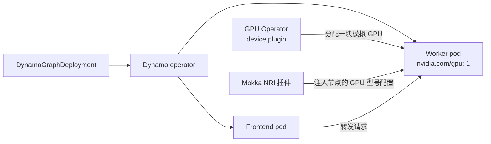

# NVIDIA Dynamo

在一台 GPU 都没有的集群上，用 [NVIDIA Dynamo](https://github.com/ai-dynamo/dynamo) 提供一个 OpenAI 兼容的接口。这里用的是真正的 Dynamo operator 来部署推理图，真正的 GPU Operator 把 worker 调度到模拟 GPU 上，一次对话补全请求会完整走一遍 Dynamo 的 frontend 和 router。

## 整体是怎么串起来的

Dynamo 把推理服务拆成两部分：**frontend**（HTTP API 和路由）与运行推理引擎的 **workers**。`DynamoGraphDeployment`（DGD）描述这张推理图，Dynamo operator 据此创建 Pod。

这里每一层都是原版未改的，只有一处例外。推理引擎本身需要真正的 CUDA，因此本指南改用 Dynamo 自带的 **mocker**：一个模拟引擎，会向 router 注册、维护 KV cache、流式吐出 token，但完全不跑 GPU kernel。它输出的 token 是随机的，这是设计如此。

不过 worker 仍然照常申请 GPU，即 `nvidia.com/gpu: 1`：



device plugin 的分配动作会把模拟的 `libnvidia-ml.so` 和 `nvidia-smi` 带进 worker，但**不会**带上节点的 GPU 型号配置。[NRI 插件](../../components/nri-plugin.md) 会在容器创建时补上这份配置，于是 worker 恰好只看到分配给它的那一块 GPU。如果关掉 NRI 插件，无论节点跑的是哪个配置档，worker 都会报出默认的 `Mock NVIDIA A100-SXM4-40GB`。

## 前置条件

- [Docker](https://docs.docker.com/get-started/get-docker/) 和 [Kind](https://kind.sigs.k8s.io/)
- [Helm 3.8 或更高版本](https://helm.sh/docs/intro/install/)
- [kubectl](https://kubernetes.io/docs/reference/kubectl/) 和 [jq](https://jqlang.org/)

全程约 15 分钟，大部分时间花在拉取 GPU Operator 和 Dynamo 的镜像上。本指南用到的两个 Dynamo 镜像都是多架构的，因此在 arm64 主机上也能跑。

## 第 1 步 — 创建集群

```bash
cat > kind.yaml <<'EOF'
kind: Cluster
apiVersion: kind.x-k8s.io/v1alpha4
nodes:
  - role: control-plane
  - role: worker
EOF

kind create cluster --name dynamo --config kind.yaml
```

第 2 步启动 Mokka 时，它的节点守护进程会一次性把 containerd 配置好，同时满足 GPU Operator 和 NRI 插件的需要，所以集群不用再做别的准备；详见 [容器运行时配置](../../components/node-daemon.md#container-runtime-setup)。

## 第 2 步 — 安装 Mokka 并启用 NRI 插件

```bash
helm install nvml-mock oci://ghcr.io/nvidia/k8s-test-infra/chart/nvml-mock \
  --namespace mokka --create-namespace \
  --set nri.enabled=true \
  --set 'nri.excludedNamespaces={gpu-operator}' \
  --wait --timeout 300s
```

`kubectl -n mokka get pods -o wide` 应该能看到每个节点上都跑着一个 `nvml-mock` Pod，NRI 插件就在其中，容器名为 `nvml-mock-nri`。

!!! note "国内镜像拉取"
    本指南会从 `ghcr.io`（nvml-mock）、`helm.ngc.nvidia.com` / `nvcr.io`（GPU Operator、Dynamo 平台）拉取镜像。若这些镜像源拉取缓慢或超时，可给相关 chart 的镜像加私有仓库前缀（如给 `nvml-mock` 加 `--set global.imageRegistry=harbor.heilansc.com/ghcr.io`）。具体做法与示例见[国内镜像加速](../README.md#domestic-mirror)。

`excludedNamespaces` 用来让插件避开 GPU Operator 的 Pod，后者和 [GPU Operator 指南](../gpu-operator.md) 里一样，不需要这个插件。在 0.4.x 版本上，如果不加这项，插件会把 operator 的 validator 也注入一遍，而每次 validator 启动都会在节点上再多叠一层挂载；参见 [启用 NRI 后节点上的挂载会不断累积](../../troubleshooting.md#mounts-pile-up-on-a-node-with-nri-enabled)。

## 第 3 步 — 安装 GPU Operator

和 [GPU Operator 指南](../gpu-operator.md#step-3--install-the-gpu-operator) 里的做法完全一致：先写好 `gpu-operator-values.yaml` 覆盖文件，再用它安装。chart 版本请固定住：

```bash
helm repo add nvidia https://helm.ngc.nvidia.com/nvidia && helm repo update

helm install gpu-operator nvidia/gpu-operator --version v26.3.3 \
  --namespace gpu-operator --create-namespace \
  -f gpu-operator-values.yaml \
  --wait --timeout 600s

kubectl get node dynamo-worker -o jsonpath='{.status.allocatable.nvidia\.com/gpu}'
# 4 —— gb300 默认配置档有 4 个设备
```

等这个数字变成非零再往下走。在 device plugin 注册上来之前，Dynamo worker 没有可调度的地方。

!!! warning "目前请停留在 v26.3.x"
    GPU Operator v26.7.1 会让所有子组件都依赖 `/proc/modules` 里的一行 `nvidia`，而 Mokka 无法向那些容器提供这一行，结果 GFD、device plugin 和 `dcgm-exporter` 都永远起不来。

## 第 4 步 — 安装 Dynamo 平台

```bash
helm install dynamo-platform \
  https://helm.ngc.nvidia.com/nvidia/ai-dynamo/charts/dynamo-platform-1.5.0.tgz \
  --namespace dynamo-system --create-namespace \
  --wait --timeout 300s
```

这一步只装 operator。etcd、NATS、Grove 和 KAI Scheduler 都是可选项，默认关闭；一张聚合式推理图不需要它们。

`--wait` 很关键：operator 是通过 init 容器安装自己的 CRD 的，在这之前 `DynamoGraphDeployment` 这个类型根本还不存在。

## 第 5 步 — 部署推理图

```bash
cat > qwen3.yaml <<'EOF'
apiVersion: nvidia.com/v1beta1
kind: DynamoGraphDeployment
metadata:
  name: qwen3
  namespace: dynamo-system
spec:
  components:
    - name: Frontend
      type: frontend
      replicas: 1
      podTemplate:
        spec:
          containers:
            - name: main
              image: nvcr.io/nvidia/ai-dynamo/dynamo-planner:1.5.0
    - name: decode
      type: decode
      replicas: 1
      podTemplate:
        spec:
          containers:
            - name: main
              image: nvcr.io/nvidia/ai-dynamo/dynamo-planner:1.5.0
              workingDir: /workspace
              command: [python3, -m, dynamo.mocker]
              args:
                - --model-path
                - Qwen/Qwen3-0.6B
                - --model-name
                - Qwen/Qwen3-0.6B
                - --speedup-ratio
                - "1.0"
              resources:
                limits:
                  nvidia.com/gpu: "1" # (1)!
EOF

kubectl apply -f qwen3.yaml
kubectl -n dynamo-system wait dgd/qwen3 --for=condition=Ready --timeout=600s
```

1. Dynamo 自带的 mocker 示例本身不申请 GPU。这里加上这次申请，才能让 worker 被放到模拟 GPU 节点上，并拿到模拟驱动。

没有专门的 mocker 镜像：mocker 依赖的 Python 包就随 `dynamo-planner` 一起发布。`Qwen/Qwen3-0.6B` 是无需申请的模型，因此不需要 Hugging Face token。

## 第 6 步 — 验证

worker 应该只看到分配给它的那一块 GPU，而且型号就是节点的配置档：

```bash
WORKER=$(kubectl -n dynamo-system get pod \
  -l nvidia.com/dynamo-graph-deployment-name=qwen3,nvidia.com/dynamo-component-type=decode \
  -o jsonpath='{.items[0].metadata.name}')

kubectl -n dynamo-system exec "$WORKER" -- nvidia-smi -L
# GPU 0: NVIDIA GB300 NVL (UUID: GPU-...)

kubectl get node dynamo-worker -o jsonpath='{.metadata.labels.nvidia\.com/gpu\.product}'
# NVIDIA-GB300-NVL
```

然后通过 frontend 发一个请求：

```bash
kubectl -n dynamo-system port-forward svc/qwen3-frontend 8000:8000 &

curl -s localhost:8000/v1/chat/completions \
  -H 'Content-Type: application/json' \
  -d '{"model": "Qwen/Qwen3-0.6B",
       "messages": [{"role": "user", "content": "Hello from a mock GPU"}],
       "max_tokens": 16}' | jq '{content: .choices[0].message.content, usage}'
```

`content` 是一串无意义的噪声，真正有意义的是 `usage.completion_tokens` 等于 `max_tokens`——这说明这些 token 确实是从 worker 出发、经过 router 返回的。

## 排查问题

**worker 报的是 `Mock NVIDIA A100-SXM4-40GB`，或者 UUID 形如 `GPU-4d4f434b-…`。**
说明模拟库没找到型号配置，退回了内置的默认值。原因通常是 NRI 插件没开，或者 worker 创建得比插件注册还早——NRI 只在容器创建那一刻做修改。检查 worker 所在节点上的 `nvml-mock` Pod 是否 Ready、`nvml-mock-nri` 容器是否在运行，然后删掉 worker Pod 让 operator 重建它。

**worker 明明在跑，`/v1/models` 却是空的，请求返回 404。**
推理图刚报告 Ready 后的几秒内属于正常：frontend 还没发现 worker，重试即可。如果两分钟后依然为空，说明 frontend 漏掉了 worker——冷启动时 frontend 可能比 worker 早好几分钟起来，就会发生这种情况。删掉 frontend Pod，新起来的那个会在启动时发现 worker。

**worker 一直是 `Pending`。**
节点还没有对外提供 `nvidia.com/gpu`。检查 GPU Operator 的 device plugin 是否在运行：`kubectl -n gpu-operator get pods`。

**`kubectl apply` 报 `no matches for kind "DynamoGraphDeployment"`。**
operator 还没把 CRD 装好。带上 `--wait` 重跑第 4 步的安装，或者等它的 Pod 变成 `Ready`。

更多症状见 [排查指南](../../troubleshooting.md)。

## 从源码仓库运行

克隆仓库后，Tilt 环境会从源码构建 Mokka，跑起同一套组件，并额外提供一个按钮做端到端断言：

```bash
make cluster-create
tilt up -- --dynamo
```

参见 [本地开发](../../contributing/local-development.md#adding-consumers)。

## 清理

```bash
kind delete cluster --name dynamo
```

## 延伸阅读

| 想了解 | 参见 |
|---|---|
| GPU Operator 覆盖文件里每个值的作用 | [NVIDIA GPU Operator](../gpu-operator.md) |
| NRI 插件会注入哪些容器，以及原因 | [NRI Plugin](../../components/nri-plugin.md) |
| Dynamo 运行时动态调整 GPU 状态 | [运行时控制](../../nvml-mock-ctl.md) |
| Dynamo 的 mocker 引擎 | [Dynamo：用 Mocker 模拟 Kubernetes Deployment](https://docs.nvidia.com/dynamo/v1.4.1/kubernetes/operations/dynosim/live-simulation-with-mocker) |
