# 在 Amazon EKS 上运行 Mokka

在只有 CPU 的 Amazon EKS 工作节点上安装 Mokka，让它对外宣称有模拟 GPU，然后从一个「干净」的普通业务镜像里直接运行未经修改的 `nvidia-smi`。

本篇假设你已经有一个 EKS 集群。如果还没有，可以用可选的 Terraform 方案临时创建一个参考集群。注意：它会创建**计费的 AWS 资源**，用完记得销毁。

## 这篇指南验证什么

本流程要验证的是：

- Mokka 能否在标准托管 CPU 节点上完成容器运行时配置（这类节点既没有 NVIDIA 软件，也没有物理 GPU）；
- NVIDIA device plugin、NVIDIA runtime、容器设备接口（CDI）与 Mokka 之间的配合是否正常；
- Mokka 能否只部署在专用的托管节点组上；
- 模拟 GPU 能否注入到一个普通的应用容器里。

参考配置刻意做得很小，但横跨两个可用区，用来验证 DaemonSet 的调度是否覆盖到每个节点：

| 组件 | 验证时使用的取值 | 为什么这样选 |
|---|---|---|
| 区域 | `us-west-2` | 只是示例默认值，可在 `terraform.tfvars` 里改 |
| Kubernetes | EKS `1.35` | 与当前 Mokka 在 Kind 上的测试目标版本一致 |
| 工作节点 | 2 台按需计费的 `t3.large` | 纯 CPU，内存足够跑系统组件和 Mokka Pod |
| 节点镜像 | EKS 优化版标准 AL2023 x86_64，`1.35.7-20260911` | 原生 containerd 跑在 systemd 下，且不带任何 NVIDIA 软件，因此 NVIDIA 运行时完全由 Mokka 来装 |
| 节点网络位置 | 两个可用区的私有子网，共用一个 NAT 网关 | 每个 worker 跑一个 Mokka Pod，worker 不需要公网 IP，同时把参考集群的 NAT 成本压低 |
| Mokka | 最新版；最后一次验证用的是 `0.5.0` + `gb300` 配置档 | 下面的安装命令取最新发布的 chart，其默认镜像标签就是 chart 的 appVersion |
| Device plugin | `nvcr.io/nvidia/k8s-device-plugin:v0.18.2` | 通过 Mokka 的 NVML 实现对外暴露 `nvidia.com/gpu` |
| Container toolkit | `1.19.1`，随 Mokka `0.5.0` 镜像一起提供 | Mokka 在每个 worker 上安装 NVIDIA runtime 和 CDI hook，并向 containerd 注册该运行时 |

这些版本号记录的是一个**可复现的验证目标**，不代表 AWS 的支持承诺。升级 Kubernetes 或 AL2023 版本后，请重新跑一遍「干净业务镜像」测试，不要想当然地认为运行时配置没变。

!!! warning "请使用测试用的 AWS 账号"

    可选的 Terraform 配置会创建 IAM 角色、网络、EKS 集群和 EC2 实例。请使用隔离的账号，或先就这些资源取得授权。`aws_account_id` 变量能防止误把资源建到别的账号上，但它不能替代最小权限的 IAM 策略。

## 前置条件

无论走哪条路径，本地都要先装好：

- [kubectl](https://kubernetes.io/docs/tasks/tools/)
- [Helm](https://helm.sh/docs/intro/install/) 3.8 或更高版本
- `curl` 和 `jq`

此外还需要一个 EKS 集群，其中至少有一台专用的 Linux x86_64 CPU worker，节点镜像里的 containerd 必须运行在 systemd 下（标准 AL2023 镜像就满足）。原因如下：Mokka 需要特权 Pod 和 `hostPath` 卷；它会在每个 worker 上安装 NVIDIA 容器运行时，并把它设为 containerd 的默认 runtime handler（`nvidia`），且工作在 CDI 模式。因此 worker 既不需要物理 GPU，也不需要预装 NVIDIA 软件。
[容器运行时配置](../../../../components/node-daemon.md#container-runtime-setup) 列出了节点上具体会被改动的内容。

如果节点镜像本身已经装了 NVIDIA Container Toolkit（例如加速版 AL2023 镜像），Mokka 会保持原样不动。此时该运行时必须已经是 CDI 模式，因为默认的 `auto` 模式会尝试初始化一块物理 GPU。

先设置好集群相关的变量。其中 AWS 开头的变量只有在使用可选的参考集群时才用得上：

```bash
export MOKKA_AWS_PROFILE=default
export MOKKA_AWS_REGION=us-west-2
export MOKKA_CLUSTER=mokka-817
export MOKKA_CONTEXT=mokka-817
```

## 1. 下载安装所需文件

本指南使用已发布的镜像和本页同目录下的配置文件，不需要克隆源码仓库。

```bash
mkdir mokka-eks-guide
cd mokka-eks-guide

export MOKKA_ASSET_BASE=https://raw.githubusercontent.com/NVIDIA/k8s-test-infra/main/docs/guides/install/aws/eks

for file in mokka-values.yaml device-plugin-values.yaml verify-workload.yaml; do
  curl -fsSLO "${MOKKA_ASSET_BASE}/${file}"
done
```

这些文件会把 Mokka 和 device plugin 限定在带有 `mokka.nvidia.com/type=sgpu` 标签的节点上。

## 2. 选择集群方案

### 使用已有集群

把 `MOKKA_CONTEXT` 设成该集群在 kubeconfig 里的 context。挑出专用的 CPU worker 并逐个打标签；**不要**给真正的 GPU 节点或共用的通用节点池打这个标签：

```bash
kubectl --context "${MOKKA_CONTEXT}" get nodes -o wide
kubectl --context "${MOKKA_CONTEXT}" label node \
  <worker-name> mokka.nvidia.com/type=sgpu
```

Mokka 配置运行时时会重启被标记节点上的 containerd，Pod 停止时还会再重启一次——这也是不要给共用节点打标签的另一个理由。完成后直接跳到 [第 4 步](#4-install-mokka)。

### 新建参考集群

继续看第 3 步。随附的 Terraform 会创建两台 worker 并打好标签。它只是一个可选的复现辅助工具，并不是安装 Mokka 的必要条件。

## 3. 创建可选的参考集群

安装 [AWS CLI v2](https://docs.aws.amazon.com/cli/latest/userguide/getting-started-install.html) 和 [Terraform](https://developer.hashicorp.com/terraform/install) 1.5.7 或更高版本。你的 AWS 身份需要具备管理 EKS、EC2 网络与实例、IAM 角色、KMS 密钥以及 CloudWatch 日志组的权限。生产账号请使用严格收敛的权限范围。

!!! warning "集群创建者管理员权限仅供参考集群使用"

    模板里设置了 `enable_cluster_creator_admin_permissions = true`。EKS 模块会创建一条访问条目，把 `AmazonEKSClusterAdminPolicy` 授予执行 Terraform 的身份，也就是完整的 cluster-admin 权限。这样一次性测试集群的创建者就能直接操作它，但这**不是**推荐的生产访问模型。生产部署应显式管理访问条目，只给每个操作员或角色授予其所需的最小权限。

下载 Terraform 文件：

```bash
mkdir terraform
for file in versions.tf variables.tf main.tf outputs.tf \
  terraform.tfvars.example .terraform.lock.hcl; do
  curl -fsSLo "terraform/${file}" "${MOKKA_ASSET_BASE}/terraform/${file}"
done
```

放在你的 VPC 里的是 worker 节点，控制平面不在其中。worker 使用标准 AL2023 镜像，启动阶段不做任何改动；containerd 由 Mokka 在第 4 步里配置。具体配置见 [`terraform/main.tf`](terraform/main.tf)。

### 完成认证并收紧访问范围

按你平时的方式登录 AWS CLI。以 IAM Identity Center（SSO）为例：

```bash
aws sso login --profile "${MOKKA_AWS_PROFILE}"
aws sts get-caller-identity --profile "${MOKKA_AWS_PROFILE}"
```

确认返回的账号确实是你要修改的那个。然后准备 Terraform 输入：

```bash
cp terraform/terraform.tfvars.example terraform/terraform.tfvars
curl -fsS https://checkip.amazonaws.com
```

编辑 `terraform/terraform.tfvars`，替换两处：

- 把 `aws_account_id` 换成 `get-caller-identity` 返回的 12 位账号 ID；
- 把示例里的 API 访问 CIDR 换成上一步显示的公网 IP，并加上 `/32`。

模板会拒绝 `0.0.0.0/0`。EKS 的公网端点只允许名单里的 CIDR 访问，私网端点则始终在 VPC 内可用。

Terraform 的 AWS provider 可能会从别的凭据来源取到凭据。请在**每次**执行 Terraform 操作前，把指定 profile 的凭据显式导出到当前 shell：

```bash
eval "$(aws configure export-credentials \
  --profile "${MOKKA_AWS_PROFILE}" --format env)"
```

### 执行 Terraform

```bash
cd terraform
terraform init
terraform fmt -check -recursive
terraform validate
terraform plan -out=mokka.tfplan
terraform apply mokka.tfplan
cd ..
```

创建通常需要 15–25 分钟。请保留生成的 `terraform/terraform.tfstate` 文件，精确销毁集群时需要它。

配置 kubectl 并确认集群可用：

```bash
aws eks update-kubeconfig \
  --profile "${MOKKA_AWS_PROFILE}" \
  --region "${MOKKA_AWS_REGION}" \
  --name "${MOKKA_CLUSTER}" \
  --alias "${MOKKA_CONTEXT}"

kubectl --context "${MOKKA_CONTEXT}" wait \
  --for=condition=Ready nodes --all --timeout=10m
kubectl --context "${MOKKA_CONTEXT}" get nodes -o wide
kubectl --context "${MOKKA_CONTEXT}" get pods -n kube-system
```

预期看到两台处于 Ready 的 AL2023 节点，分属不同可用区，且都没有外网 IP。CoreDNS、`aws-node` 和 `kube-proxy` 应处于 Running。

## 4. 安装 Mokka <a id="4-install-mokka"></a>

```bash
helm upgrade --install nvml-mock \
  oci://ghcr.io/nvidia/k8s-test-infra/chart/nvml-mock \
  --kube-context "${MOKKA_CONTEXT}" \
  --namespace mokka \
  --create-namespace \
  --values mokka-values.yaml \
  --wait --timeout 5m

kubectl --context "${MOKKA_CONTEXT}" \
  --namespace mokka get daemonset,pods -o wide
kubectl --context "${MOKKA_CONTEXT}" \
  --namespace mokka exec daemonset/nvml-mock -- nvidia-smi -L
```

每台 worker 上应该各有一个 Ready 的 Mokka Pod。上面的命令会列出四块 `NVIDIA GB300 NVL` 设备，这说明 Mokka 已在节点上就位：模拟驱动目录、配置、设备节点和 CDI 规格文件都已生成。

!!! note "国内镜像拉取"
    本指南会从 `ghcr.io`（nvml-mock）和 `nvcr.io`（NVIDIA device plugin）拉取镜像。若这些镜像源拉取缓慢或超时，可给相关 chart 的镜像加私有仓库前缀（如给 `nvml-mock` 加 `--set global.imageRegistry=harbor.heilansc.com/ghcr.io`；device plugin 在 `device-plugin-values.yaml` 里把镜像 repository 改为 `harbor.heilansc.com/nvcr.io/nvidia/k8s-device-plugin`）。具体做法与示例见[国内镜像加速](../README.md#domestic-mirror)。

只有当所在 worker 的 containerd 把 `nvidia` 作为默认 runtime handler 之后，Mokka Pod 才会变成 Ready；为达到这个状态，worker 上的 containerd 会被重启一次。`mokka-values.yaml` 把 containerd 的配置目录（Mokka 配置文件存放处）设为 `/etc/containerd/config.d`。`nodeadm` 每次启动时改写的 `config.toml` 本来就会导入这个目录，因此这套配置不依赖某条会在下次启动时被删掉的 `imports` 条目。

## 5. 对外暴露模拟 GPU

Mokka 负责「让设备看起来像真的」，而未加修改的 NVIDIA device plugin 负责告诉 kubelet：这些设备是可以被调度的资源。用随附的 values 安装官方 chart，它会做三件事：把插件指向 Mokka 准备好的驱动目录、只选中模拟 GPU 的 worker、以及去掉 chart 里针对物理 GPU 的节点亲和性约束：

```bash
helm repo add nvdp https://nvidia.github.io/k8s-device-plugin
helm repo update nvdp

helm upgrade --install nvidia-device-plugin \
  nvdp/nvidia-device-plugin \
  --version 0.18.2 \
  --kube-context "${MOKKA_CONTEXT}" \
  --namespace nvidia-device-plugin \
  --create-namespace \
  --values device-plugin-values.yaml \
  --wait --timeout 5m

kubectl --context "${MOKKA_CONTEXT}" \
  --namespace nvidia-device-plugin rollout status \
  daemonset/nvidia-device-plugin --timeout=5m

kubectl --context "${MOKKA_CONTEXT}" get nodes -o json | jq -r '
  .items[] |
  [.metadata.name,
   .metadata.labels["mokka.nvidia.com/type"],
   .status.allocatable["nvidia.com/gpu"]] |
  @tsv'
```

两台节点旁应分别显示 `sgpu` 和 `4`。

一次 GPU 请求的完整链路如下：

```mermaid
flowchart LR
    Pod[Pod 声明 nvidia.com/gpu: 1]
    Scheduler[Kubernetes 调度器选定节点]
    Kubelet[Kubelet 选出一个已暴露的 GPU UUID]
    Plugin[NVIDIA device plugin 返回 NVIDIA_VISIBLE_DEVICES=UUID]
    Handler[containerd 通过其默认 handler nvidia 启动容器]
    Runtime[NVIDIA runtime 解析 nvidia.com/gpu=UUID]
    Spec[Mokka 生成的 /run/cdi/nvidia.yaml]
    OCI[Runtime 应用规格中的容器修改项]
    App[未修改的应用看到一块模拟 GPU]

    Pod --> Scheduler
    Scheduler --> Kubelet
    Kubelet -->|分配 UUID| Plugin
    Plugin --> Handler
    Handler --> Runtime
    Runtime --> Spec
    Spec --> OCI
    OCI --> App
```



device plugin 保持默认的发现策略和环境变量分配策略，这是有意为之。插件通过 Mokka 的驱动根目录发现模拟设备，并把它们的 UUID 上报给 kubelet。当 Pod 申请 `nvidia.com/gpu` 时，kubelet 挑一个已上报的 UUID，插件通过 `NVIDIA_VISIBLE_DEVICES` 把它返回。containerd 用默认 handler（也就是 Mokka 以 CDI 模式安装的 NVIDIA runtime）启动容器，runtime 拿这个 UUID 去匹配 Mokka 生成的 `nvidia.com/gpu` 规格，并应用其中的容器修改项。本指南验证的是 device plugin 默认的 `envvar` 分配策略；CDI 原生策略使用的是由 device plugin 自己维护的另一套规格，不在本篇范围内。

## 6. 用一个「干净」的业务容器验证

验证用的镜像就是普通 Ubuntu，里面既没有 `nvidia-smi` 也没有 Mokka。所以只要能跑通，就证明 NVIDIA runtime 把这两样都注入了进去：

```bash
kubectl --context "${MOKKA_CONTEXT}" delete pod mokka-verify \
  --ignore-not-found
kubectl --context "${MOKKA_CONTEXT}" apply -f verify-workload.yaml
kubectl --context "${MOKKA_CONTEXT}" wait \
  --for=jsonpath='{.status.phase}'=Succeeded \
  pod/mokka-verify --timeout=3m
kubectl --context "${MOKKA_CONTEXT}" logs mokka-verify
```

预期输出里只有一块已分配的 GB300，而不是全部四块：

```text
GPU 0: NVIDIA GB300 NVL (UUID: GPU-b300b300-...)
```

这一条命令同时验证了三件事：Kubernetes 正确调度了 GPU 请求；NVIDIA runtime 把模拟驱动注入进了普通镜像；所选的 GB300 配置确实传到了消费方。

## 排查问题

### Terraform 用错了 AWS 身份

运行 `aws sts get-caller-identity`，重新导出所选 profile 的凭据后重试。provider 的 `allowed_account_ids` 检查会在账号与 `terraform.tfvars` 不一致时拦下 apply。

### kubectl 连不上 API server

可能是你的公网 IP 变了。更新 `terraform.tfvars` 中的 `cluster_endpoint_public_access_cidrs`，重新导出 AWS 凭据，再执行一次 `terraform apply`。

### device plugin 报告没有 GPU

先确认 Mokka 已经 Ready，再看插件日志：

```bash
kubectl --context "${MOKKA_CONTEXT}" --namespace mokka get pods -o wide
kubectl --context "${MOKKA_CONTEXT}" --namespace nvidia-device-plugin logs \
  daemonset/nvidia-device-plugin --tail=100
```

出现「缺少可选图形库」之类的告警是正常的：Mokka 提供的是 NVML/CUDA 管理接口，不是完整的物理 GPU 驱动。

### 业务容器报 `nvidia-smi: not found`

说明该 worker 上的 containerd 没有用 NVIDIA runtime 启动这个 Pod：运行时配置没成功，该 worker 的 Mokka Pod 也不是 Ready。
[排查指南](../../../../troubleshooting.md#pods-get-no-mock-driver-or-the-node-pod-is-not-ready) 说明了去哪里看 Mokka Pod 记录的原因。

## 清理

如果还想继续用这个集群做实验，可以只删掉本次创建的 Kubernetes 测试对象：

```bash
kubectl --context "${MOKKA_CONTEXT}" delete -f verify-workload.yaml
helm --kube-context "${MOKKA_CONTEXT}" uninstall nvidia-device-plugin \
  --namespace nvidia-device-plugin
helm --kube-context "${MOKKA_CONTEXT}" uninstall nvml-mock --namespace mokka
```

卸载 Mokka 会从每个 worker 的 containerd 里移除 `nvidia` handler，containerd 回退到自己的默认 handler，并就地重启一次。

如果你创建的是可选的参考集群，用完后请销毁它的全部 AWS 资源：

```bash
eval "$(aws configure export-credentials \
  --profile "${MOKKA_AWS_PROFILE}" --format env)"
terraform -chdir=terraform destroy
```

检查销毁计划，输入 `yes` 并等待完成。确认输出 `Destroy complete` 之后，再删除本地的指南目录和 Terraform state 文件。
