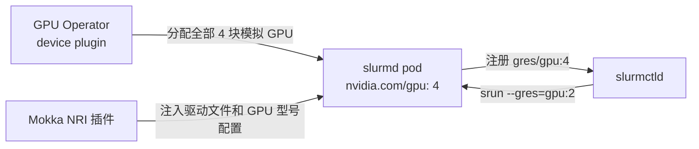

# Slinky（在 Kubernetes 上跑 Slurm）

用 SchedMD 的 [Slinky](https://github.com/SlinkyProject/slurm-operator) operator，在一台 GPU 都没有的集群上跑起一套基于模拟 GPU 的 Slurm 集群。真正的 `slurmd` 会自己发现 GPU，把它们注册为通用资源（GRES），然后 `srun --gres=gpu:N` 就能把作业调度上去。

## 整体是怎么串起来的

Slinky 把 Slurm 的各个守护进程都跑成 Pod。一组 `slurmd` Pod 称为一个 **NodeSet**，其中每个 Pod 就是一台 Slurm 计算节点；控制器 `slurmctld` 负责把作业调度到这些节点上。

每个 `slurmd` Pod 都会申请所在 Kubernetes 节点上的**全部** GPU，再由 Slurm 把这些 GPU 分给各个作业。真实的 GPU 节点上也是这么跑的：



没有人直接告诉 `slurmd` 它有几块 GPU。只要 `gres.conf` 里写了 `AutoDetect=nvidia`，它就会去读 NVIDIA 内核驱动公开的文件：先列 `/proc/driver/nvidia/gpus/` 找出所有 GPU，再从各自的 `information` 文件里读出型号、UUID 和次设备号，最后从 `/sys/bus/pci/drivers/nvidia/<pci-address>/local_cpulist` 读出 CPU 亲和性。这些文件由 Mokka 提供，而 [NRI 插件](../../components/nri-plugin.md) 负责让它们在 `slurmd` 容器内部可见。由于 runc 不允许在 `/proc` 里做挂载，实际是靠 `libmockfs.so` 拦截这些读取操作实现的，详见 [函数库与垫片](../../components/libraries-and-shims.md#libmockfs)。

!!! note "需要 nvml-mock 0.5.0 或更高版本"
    更早的版本不提供上面这些驱动文件，结果就是 `slurmd` 找不到任何 GPU，每个节点都会注册成 `Gres=(null)`。

## 前置条件

- [Docker](https://docs.docker.com/get-started/get-docker/) 和 [Kind](https://kind.sigs.k8s.io/)
- [Helm 3.8 或更高版本](https://helm.sh/docs/intro/install/)
- [kubectl 1.33 或更高版本](https://kubernetes.io/docs/reference/kubectl/)：需要它的 `kubectl wait --for=create` 来等待标签选择器匹配到对象

全程约 20 分钟，大部分时间花在拉取 GPU Operator 和 Slurm 的镜像上。

## 第 1 步 — 创建集群

```bash
cat > kind.yaml <<'EOF'
kind: Cluster
apiVersion: kind.x-k8s.io/v1alpha4
nodes:
  - role: control-plane
  - role: worker
EOF

kind create cluster --name slinky --config kind.yaml
```

第 2 步启动 Mokka 时，它的节点守护进程会一次性把 containerd 配置好，同时满足 GPU Operator 和 NRI 插件的需要，所以集群不用再做别的准备；详见 [容器运行时配置](../../components/node-daemon.md#container-runtime-setup)。

## 第 2 步 — 安装 Mokka

```bash
helm install nvml-mock oci://ghcr.io/nvidia/k8s-test-infra/chart/nvml-mock \
  --namespace mokka --create-namespace \
  --wait --timeout 300s
```

NRI 插件默认开启。默认的 `gb300` 配置档给每个节点 4 块 GPU，第 5 步的配置依赖这个数量。

!!! note "国内镜像拉取"
    本指南会从 `ghcr.io`（nvml-mock、cert-manager、Slurm）和 `helm.ngc.nvidia.com` / `nvcr.io`（GPU Operator）拉取镜像。若这些镜像源拉取缓慢或超时，可给相关 chart 的镜像加私有仓库前缀（如给 `nvml-mock` 加 `--set global.imageRegistry=harbor.heilansc.com/ghcr.io`，给 GPU Operator 的各镜像加 `harbor.heilansc.com/nvcr.io` 前缀）。具体做法与示例见[国内镜像加速](../README.md#domestic-mirror)。

## 第 3 步 — 安装 GPU Operator

和 [GPU Operator 指南](../gpu-operator.md#step-3--install-the-gpu-operator) 里的做法完全一致：先写好 `gpu-operator-values.yaml` 覆盖文件，再用它安装：

```bash
helm repo add nvidia https://helm.ngc.nvidia.com/nvidia && helm repo update

helm install gpu-operator nvidia/gpu-operator --version v26.3.3 \
  --namespace gpu-operator --create-namespace \
  -f gpu-operator-values.yaml \
  --wait --timeout 600s

kubectl get node slinky-worker -o jsonpath='{.status.allocatable.nvidia\.com/gpu}'
# 4
```

等这个数字变成非零再往下走。在 device plugin 把 GPU 注册上来之前，`slurmd` 没有任何可调度的地方。

## 第 4 步 — 安装 Slinky operator

operator 的准入 webhook 要用 [cert-manager](https://cert-manager.io/) 签发的证书，所以先装 cert-manager：

```bash
helm install cert-manager oci://quay.io/jetstack/charts/cert-manager \
  --version v1.21.2 \
  --namespace cert-manager --create-namespace \
  --set crds.enabled=true \
  --wait --timeout 300s

helm install slurm-operator-crds oci://ghcr.io/slinkyproject/charts/slurm-operator-crds \
  --version 1.2.3

helm install slurm-operator oci://ghcr.io/slinkyproject/charts/slurm-operator \
  --version 1.2.3 \
  --namespace slinky --create-namespace \
  --wait --timeout 300s
```

operator、它的 CRD 和下一步要用的 `slurm` chart 是一起发布的，三者请保持同一个版本。

## 第 5 步 — 部署 Slurm 集群

```bash
cat > slurm-values.yaml <<'EOF'
configFiles:
  gres.conf: |
    AutoDetect=nvidia # (1)!
controller:
  extraConfMap:
    GresTypes: ["gpu"] # (2)!
nodesets:
  gpu:
    scalingMode: DaemonSet # (3)!
    slurmd:
      resources:
        limits:
          nvidia.com/gpu: 4 # (4)!
    podSpec:
      nodeSelector:
        feature.node.kubernetes.io/pci-10de.present: "true" # (5)!
partitions:
  all:
    enabled: true
EOF

helm install slurm oci://ghcr.io/slinkyproject/charts/slurm \
  --version 1.2.3 \
  --namespace slurm --create-namespace \
  -f slurm-values.yaml

kubectl -n slurm wait pod -l app.kubernetes.io/name=slurmd \
  --for=create --timeout=300s
kubectl -n slurm wait pod -l app.kubernetes.io/name=slurmd \
  --for=condition=Ready --timeout=600s
```

逐条解释：

1. `slurmd` 自己从 Mokka 提供的驱动文件里发现 GPU，所以 `gres.conf` 和节点的 `Gres` 都不用把 GPU 列出来。
2. 少了这一项，`slurmctld` 会丢掉每个节点上报的 GPU，节点最终注册成 `Gres=(null)`。chart 1.2.3 默认不会设置它。
3. 每个 GPU 节点跑一个 `slurmd`，这样 Slurm 集群会随 Kubernetes 集群一起扩容。
4. 申请节点上的全部 GPU，Slurm 才能把它们分给不同作业。这个值必须和配置档里的 GPU 数量一致。同时，正是这次 GPU 分配让 NRI 插件把驱动文件交给 `slurmd`——它只注入持有 GPU 的容器。
5. Mokka 通过 Node Feature Discovery 给自己的节点打上 NVIDIA PCI 厂商 ID 标签，因此 `slurmd` 只会落在模拟 GPU 节点上。

`slurmd` Pod 是在 `helm install` 返回之后才由 operator 创建的，所以第一条 `kubectl wait` 是等它们「出现」。如果一上来就等 `Ready`，会直接报 `no matching resources found`。

## 第 6 步 — 验证

节点会进入 `idle` 状态，并显示 4 块 GPU：

```bash
kubectl -n slurm exec slurm-controller-0 -c slurmctld -- sinfo -N -o '%N %T %G'
# NODELIST STATE GRES
# slinky-worker idle gpu:nvidia_gb300_nvl:4(S:0)
```

Slurm 会用读到的型号给 GPU 类型命名；`(S:0)` 则是它根据 GPU 的 `local_cpulist` 推算出的 CPU 插槽编号。两者都会随配置档变化。不加类型限定的 `--gres=gpu:2` 可以匹配任意类型。

接着提交一个申请 2 块 GPU 的作业：

```bash
kubectl -n slurm exec slurm-controller-0 -c slurmctld -- \
  srun -N1 --gres=gpu:2 bash -c 'echo "CUDA_VISIBLE_DEVICES=$CUDA_VISIBLE_DEVICES"; nvidia-smi -L'
# CUDA_VISIBLE_DEVICES=0,1
# GPU 0: ...
```

真正有意义的是 `CUDA_VISIBLE_DEVICES=0,1`：它说明 Slurm 从节点注册的 4 块 GPU 里分出了 2 块给这个作业。

## 哪些行为没有被模拟

**作业里的 `nvidia-smi` 会列出节点上的所有 GPU。** 模拟层是根据进程能打开哪些 `/dev/nvidia*` 设备节点，来决定让它「看见」哪些 GPU 的。真实 Slurm 靠 cgroup 设备规则把作业限制在自己的 GPU 范围内，而模拟层没有实现这一层。`CUDA_VISIBLE_DEVICES` 仍然是正确的，CUDA 程序认的也正是它。

**作业读到的是节点上真实的驱动文件。** Slurm 传给作业的是执行 `srun` 那个 shell 的环境，而不是 `slurmd` 的环境，所以 NRI 插件预加载进 `slurmd` 的垫片在作业里并不生效。作业里的 NVML 仍会报告节点的配置档，但如果作业直接去读 `/proc/driver/nvidia` 或 PCI sysfs，看到的就是真实文件；参见 [哪些容器会被注入](../../components/nri-plugin.md#which-containers-are-injected)。

**作业不会真的执行 CUDA kernel。** 参见 [CUDA 不在模拟范围内](../../faq.md#can-i-run-cuda-workloads-against-mokka)。

## 排查问题

**节点显示 `Gres=(null)`。** 要么控制器配置里少了 `GresTypes`，要么 `slurmd` 压根没找到 GPU。先确认它能不能看到驱动文件：

```bash
POD=$(kubectl -n slurm get pod -l app.kubernetes.io/name=slurmd -o jsonpath='{.items[0].metadata.name}')
kubectl -n slurm exec "$POD" -c slurmd -- ls /proc/driver/nvidia/gpus
```

目录为空或不存在，说明 NRI 插件没有注入这个 Pod，或者 Mokka 版本低于 0.5.0。检查该节点上的 `nvml-mock` Pod 是否 Ready、其中的 `nvml-mock-nri` 容器是否在运行，然后删掉 `slurmd` Pod 让 operator 重建。NRI 只在容器创建那一刻做修改。

**重装 Mokka 或切换配置档后，GPU 作业报 `Requested node configuration is not available`。** `slurmd` 只在启动时探测一次 GPU，而 `slurmctld` 会一直沿用节点首次注册时的 GPU–CPU 绑定关系，即便 `slurmd` 重启也不变。先删节点记录，再删 `slurmd` Pod，让每个节点重新注册一次：

```bash
kubectl -n slurm exec slurm-controller-0 -c slurmctld -- \
  scontrol delete nodename="$(kubectl -n slurm exec slurm-controller-0 -c slurmctld -- sinfo -h -N -o '%N' | paste -sd, -)"
kubectl -n slurm delete pod -l app.kubernetes.io/name=slurmd
```

**`slurmd` Pod 一直是 `Pending`。** 节点没有对外提供 `nvidia.com/gpu`，或者数量少于 Pod 申请的值。检查 `kubectl -n gpu-operator get pods`，并把第 3 步得到的可分配数与 NodeSet 里的 limit 对一下。

更多症状见 [排查指南](../../troubleshooting.md)。

## 从源码仓库运行

克隆仓库后，Tilt 环境会从源码构建 Mokka，跑起同一套组件，并额外开启到 `slurmd` Pod 的 SSH。所有 `slurmd` Pod 都 Ready 之后 Tilt 才会报告就绪，并随即打印一次 `sinfo`：

```bash
make cluster-create
tilt up -- --slinky
```

参见 [本地开发](../../contributing/local-development.md#adding-consumers)。

## 清理

```bash
kind delete cluster --name slinky
```

## 延伸阅读

| 想了解 | 参见 |
|---|---|
| GPU Operator 覆盖文件里每个值的作用 | [NVIDIA GPU Operator](../gpu-operator.md) |
| NRI 插件会注入哪些容器，以及原因 | [NRI Plugin](../../components/nri-plugin.md) |
| Slurm 的 GPU 自动探测 | [Slurm `gres.conf`](https://slurm.schedmd.com/gres.conf.html#OPT_AutoDetect) |
| Slinky 的 Helm chart 及配置项 | [Slinky 文档](https://slinky.schedmd.com) |
