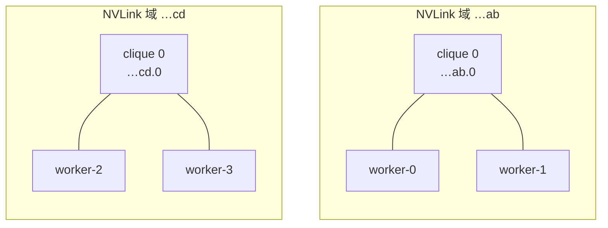
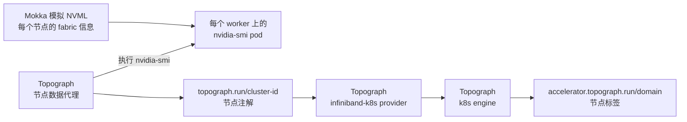

# Topograph

用 [Topograph](https://github.com/dsx-ai-factory/topograph) 管理一个由 Mokka 模拟出来的四节点 GB200 集群。Topograph 会发现哪些节点属于同一个 NVLink 域，并给每个节点打上对应标签，这样 KAI、Kueue 之类的拓扑感知调度器就能把一个多节点作业约束在单个域内。整套东西跑在一台 GPU 都没有的集群上。

## 整体是怎么串起来的

在 GB200 系统上，位于同一个 **NVLink 域**（一张由 cluster UUID 标识的 NVSwitch 交换网）内、不同托盘上的 GPU 才能通过 NVLink 互通。一个域还可以进一步划分成若干 **clique**：只有同一个 clique 内的 GPU 之间才能用 NVLink。NVML 会为每块 GPU 报告这两个值，`nvidia-smi` 里显示为 `fabric.clusterUuid` 和 `fabric.cliqueId`。

本指南会构造两个域，每个域里各有一个包含两台节点的 clique：



Mokka 的拓扑覆盖配置（chart 的 `topology` values）会让每个节点上的模拟 NVML 上报这份交换网信息。Topograph 则按它在真实 GB200 节点上的方式来发现拓扑：它的节点数据代理（一个 DaemonSet）会在本节点的 GPU Pod 里执行 `nvidia-smi`，把结果记成节点注解 `topograph.run/cluster-id`；`infiniband-k8s` provider 把每个不同的取值转成一个 accelerator 域；最后 `k8s` engine 把它回写成节点标签 `accelerator.topograph.run/domain`：



没有任何节点带 clique 标签：拓扑信息的唯一来源就是 Mokka 上报的交换网信息。

!!! note "为什么要单独起一个 `nvidia-smi` DaemonSet"
    在真实集群里，节点数据代理会在 GPU Operator 的 device plugin Pod 中跑 `nvidia-smi`。这里用一个单容器 DaemonSet 顶替它，于是本指南既不需要 GPU Operator，也不需要 DRA driver。Mokka 自己的 Pod 不能拿来当目标：Topograph 的 exec 没有指定容器，会落到 [NRI 插件](../../components/nri-plugin.md)容器里，而那里没有模拟驱动，只会报 `[N/A]`。

## 前置条件

- [Docker](https://docs.docker.com/get-started/get-docker/) 和 [Kind](https://kind.sigs.k8s.io/)
- [Helm 3.8 或更高版本](https://helm.sh/docs/intro/install/)
- [kubectl](https://kubernetes.io/docs/reference/kubectl/)

全程约 10 分钟。

## 第 1 步 — 创建四 worker 集群

每个 worker 都有一个固定的节点名，第 2 步的拓扑配置要靠它来引用。

```bash
cat > kind.yaml <<'EOF'
kind: Cluster
apiVersion: kind.x-k8s.io/v1alpha4
nodes:
  - role: control-plane
  - role: worker
    labels:
      mokka.nvidia.com/type: sgpu
    kubeadmConfigPatches:
      - |
        kind: JoinConfiguration
        nodeRegistration:
          name: worker-0
  - role: worker
    labels:
      mokka.nvidia.com/type: sgpu
    kubeadmConfigPatches:
      - |
        kind: JoinConfiguration
        nodeRegistration:
          name: worker-1
  - role: worker
    labels:
      mokka.nvidia.com/type: sgpu
    kubeadmConfigPatches:
      - |
        kind: JoinConfiguration
        nodeRegistration:
          name: worker-2
  - role: worker
    labels:
      mokka.nvidia.com/type: sgpu
    kubeadmConfigPatches:
      - |
        kind: JoinConfiguration
        nodeRegistration:
          name: worker-3
EOF

kind create cluster --name topograph --config kind.yaml
```

`mokka.nvidia.com/type=sgpu` 标记出模拟 GPU 的 worker。Mokka 和 Topograph 都按这个标签选节点，因此都不会跑到控制平面上。

## 第 2 步 — 安装带 NVLink 拓扑的 Mokka

```bash
cat > mokka-values.yaml <<'EOF'
gpu:
  profile: gb200 # (1)!
nodeSelector:
  mokka.nvidia.com/type: sgpu
topology:
  enabled: true
  domains: # (2)!
    - name: spine-1
      uuid: "00000000-0000-0000-0000-0000000000ab"
      cliques:
        - id: 0
          nodes: [worker-0, worker-1]
    - name: spine-2
      uuid: "00000000-0000-0000-0000-0000000000cd"
      cliques:
        - id: 0
          nodes: [worker-2, worker-3]
EOF

helm install nvml-mock oci://ghcr.io/nvidia/k8s-test-infra/chart/nvml-mock \
  --version 0.5.0 \
  --namespace mokka --create-namespace \
  -f mokka-values.yaml \
  --wait --timeout 300s
```

1. GB200 配置档会通过 `nvmlDeviceGetGpuFabricInfo` 上报 NVLink 交换网身份。

!!! note "国内镜像拉取"
    若 `ghcr.io` 等镜像源拉取缓慢或超时，可给 `nvml-mock` 加 `--set global.imageRegistry=harbor.heilansc.com/ghcr.io`。具体做法与示例见[国内镜像加速](../README.md#domestic-mirror)。
2. 每个 worker 按节点名出现，且恰好属于一个 clique。

## 第 3 步 — 给每个 worker 准备一个 `nvidia-smi` Pod

这个 DaemonSet 就是 Topograph 节点数据代理执行 `nvidia-smi` 的地方。它不申请 GPU，而是用注解向 Mokka 索取模拟驱动：

```bash
cat > nvidia-smi.yaml <<'EOF'
apiVersion: v1
kind: Namespace
metadata:
  name: topograph
---
apiVersion: apps/v1
kind: DaemonSet
metadata:
  name: nvidia-smi
  namespace: topograph # (1)!
spec:
  selector:
    matchLabels:
      app.kubernetes.io/name: nvidia-smi
  template:
    metadata:
      labels:
        app.kubernetes.io/name: nvidia-smi
      annotations:
        nvml-mock.nvidia.com/devices: "true" # (2)!
    spec:
      nodeSelector:
        mokka.nvidia.com/type: sgpu
      terminationGracePeriodSeconds: 1
      containers:
        - name: nvidia-smi
          image: ubuntu:24.04 # (3)!
          command: ["sleep", "infinity"]
EOF

kubectl apply -f nvidia-smi.yaml
kubectl -n topograph rollout status ds/nvidia-smi
```

1. Mokka 不会向自己的 release 命名空间 `mokka` 或 `kube-system` 里注入任何东西。
2. 即使没有 GPU 分配，NRI 插件也会把模拟驱动（含 `nvidia-smi`）和节点上的所有模拟 GPU 挂进容器。
3. 任何基于 glibc 的镜像都行，驱动由 Mokka 提供。

在每个 worker 上跑一遍代理稍后要执行的查询：

```bash
for node in worker-0 worker-1 worker-2 worker-3; do
  pod=$(kubectl -n topograph get pod -l app.kubernetes.io/name=nvidia-smi \
    --field-selector spec.nodeName=$node -o jsonpath='{.items[0].metadata.name}')
  printf '%s: ' $node
  kubectl -n topograph exec $pod -- \
    nvidia-smi --query-gpu=fabric.clusterUuid,fabric.cliqueId --format=csv,noheader \
    | sort -u
done
# worker-0: 00000000-0000-0000-0000-0000000000ab, 0
# worker-1: 00000000-0000-0000-0000-0000000000ab, 0
# worker-2: 00000000-0000-0000-0000-0000000000cd, 0
# worker-3: 00000000-0000-0000-0000-0000000000cd, 0
```

每个节点对每块 GPU 都会输出一行；因为它们都在同一个 clique 里，`sort -u` 会把四行合并成一行。

## 第 4 步 — 安装 Topograph

```bash
cat > topograph-values.yaml <<'EOF'
provider:
  name: infiniband-k8s # (1)!
  params:
    accelerator:
      source: nvidia-smi # (2)!
      nvidiaSmi:
        gpuOperatorNamespace: topograph
        devicePluginDaemonSet: nvidia-smi
    nodeSelector:
      mokka.nvidia.com/type: sgpu
engine:
  name: k8s # (3)!
config:
  requestAggregationDelay: 2s # (4)!
nodeObserver:
  topograph:
    trigger:
      nodeSelector:
        mokka.nvidia.com/type: sgpu # (5)!
EOF

helm install topograph topograph \
  --repo https://helm.ngc.nvidia.com/nvidia/topograph --version 1.1.0 \
  --namespace topograph \
  -f topograph-values.yaml \
  --wait --timeout 300s
```

1. 每个不同的 `topograph.run/cluster-id` 注解对应一个 accelerator 域。
2. 节点数据代理会在本节点的 `nvidia-smi` DaemonSet Pod 里执行 `nvidia-smi`。这些键名沿用了 GPU Operator 时代的叫法。
3. 把拓扑结果回写成节点标签。Topograph 的其他 engine 会把结果喂给 Slurm 或 Slinky。
4. chart 默认的 15 秒只是让首个结果来得更晚。
5. 每当有模拟 GPU worker 加入或退出，就重新生成一次拓扑。

## 第 5 步 — 验证

```bash
kubectl get nodes -L accelerator.topograph.run/domain
# NAME                      STATUS   ...   DOMAIN
# topograph-control-plane   Ready    ...
# worker-0                  Ready    ...   00000000-0000-0000-0000-0000000000ab.0
# worker-1                  Ready    ...   00000000-0000-0000-0000-0000000000ab.0
# worker-2                  Ready    ...   00000000-0000-0000-0000-0000000000cd.0
# worker-3                  Ready    ...   00000000-0000-0000-0000-0000000000cd.0
```

Topograph 启动后，标签可能要过几秒才出现。每个域里有两台 worker，因此读取 `accelerator.topograph.run/domain` 的调度器就能把双节点作业放进同一个域。

## 哪些行为没有被模拟

**InfiniBand 交换机层级。** `infiniband-k8s` provider 还会在代理自己的 Pod 里执行 `ibnetdiscover`，而 Mokka 不会注入那个 Pod，所以这一步会失败：Topograph 会为每个节点记一条 `failed to run ibnetdiscover`，最终拓扑里只包含 accelerator 域。

**NVLink 上不传数据。** Mokka 只上报交换网身份，不提供数据通路，因此作业放在同一个域里不会比跨两个域跑得更快。参见[哪些场景需要真实硬件](../../index.md#use-real-hardware-for)。

## 排查问题

**没有 `accelerator.topograph.run/domain` 标签。** 先看代理在各节点上记录了什么：

```bash
kubectl get nodes \
  -o custom-columns='NODE:.metadata.name,CLUSTER-ID:.metadata.annotations.topograph\.run/cluster-id'
```

某个 worker 没有值，说明代理启动时那里还没有 `nvidia-smi` Pod——代理只在启动时查询一次。确认第 3 步的 DaemonSet 已经跑起来，然后重启代理：

```bash
kubectl -n topograph rollout restart ds/topograph-node-data-broker
```

**注解的值是 `[N/A].[N/A]`。** 代理在一个没有模拟驱动的容器里执行了 `nvidia-smi`，通常是因为 `devicePluginDaemonSet` 指到了 Mokka 自己的 DaemonSet。按第 4 步改成指向 `topograph` 命名空间里的 `nvidia-smi`。Topograph 没法把 `[N/A].[N/A]` 写成标签，会在日志里带着 `Invalid value` 反复重试。

**第 3 步报 `nvidia-smi: not found`。** NRI 插件只在**容器创建时**注入，而且只作用于 `mokka` 和 `kube-system` 之外、带注解的 Pod。检查注解和命名空间，再执行 `kubectl -n topograph rollout restart ds/nvidia-smi` 重建 Pod。

**第 3 步输出的 clique 和预期不同。** `topology.domains` 里的 worker 名必须和节点名完全一致；没写进拓扑的节点会报出该配置档的默认交换网信息。

控制平面缺少 `topograph.run/instance` 注解的告警属于预期：代理不容忍控制平面的污点，本来就不会跑在那里。

更多症状见 [排查指南](../../troubleshooting.md)。

## 从源码仓库运行

克隆仓库后，Tilt 环境会从源码构建 Mokka，并在 `compute-domain` 这个 Kind 集群上跑起同一套组件：

```bash
make cluster-create PROFILE=compute-domain
tilt up -- --topograph
```

参见 [本地开发](https://github.com/NVIDIA/k8s-test-infra/blob/main/docs/contributing/local-development.md)。

## 清理

```bash
kind delete cluster --name topograph
```

## 延伸阅读

| 想了解 | 参见 |
|---|---|
| Mokka 如何模拟 NVLink 交换网身份与 IMEX | [ComputeDomain](https://github.com/NVIDIA/k8s-test-infra/blob/main/docs/guides/compute-domain/README.md) |
| 哪些容器会拿到模拟驱动，以及相关注解 | [NRI 插件](../../components/nri-plugin.md) |
| `topology` chart 配置项 | [Helm Chart Values](../../helm-chart-values.md) |
| Topograph 的 provider、engine 和 chart 配置项 | [Topograph](https://github.com/dsx-ai-factory/topograph) |
