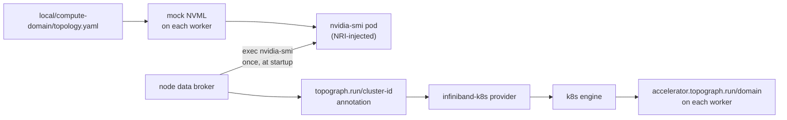

# Topograph

[Topograph](https://github.com/dsx-ai-factory/topograph) 读取每个模拟 GPU worker 的 NVLink clique，并给每个 worker 打上它的加速器域标签——拓扑感知调度器（KAI、Kueue TAS）正是消费这个标签。本目录是 `--topograph` 这个 Tilt 消费者。关于该集成展示了什么、以及如何脱离仓库检出运行它，见 [Topograph 指南](../../docs/guides/topograph/README.md)。

## 运行

```bash
make cluster-create PROFILE=compute-domain
tilt up -- --topograph
```

`--topograph` 隐含 `--compute-domain`：clique 只存在于 `compute-domain` 集群上。既不需要 `--dra`，也不需要 `--gpu-operator`。

Tilt 会部署到当前 kubectl context；`--k8s-context` 只"允许"某个 context，并不会"选中"它。想在不切换 context 的情况下与另一个集群并排运行，请用 Tilt 自己的 `--context` 标志指定它，并给第二个 Tilt 自己的 UI 端口：

```bash
tilt up --context kind-mokka-compute-domain --port 10351 -- --topograph
```

## 进入集群的内容

| Release / 资源       | 命名空间     | 说明                                                              |
|-------------------------|-------------|--------------------------------------------------------------------|
| `topograph`             | `topograph` | API server、节点观察器，以及节点数据 broker DaemonSet      |
| `topograph-nvidia-smi`  | `topograph` | broker 会 exec 进去的 `nvidia-smi` DaemonSet，每个 worker 一个 Pod |
| `nvml-mock`             | `default`   | compute-domain 那一份发布：gb200 配置档加上 NVLink 拓扑 |

## 数据通路



没有任何节点自带 clique 标签；模拟驱动是唯一的来源。该集群有两个 NVLink 域，每个域含一个由两个 worker 组成的 clique，因此 topograph 会报告两个双节点域：

| 节点     | `topograph.run/cluster-id` 与 `accelerator.topograph.run/domain` |
|----------|-------------------------------------------------------------------|
| worker-0 | `…ab.0`                                                           |
| worker-1 | `…ab.0`                                                           |
| worker-2 | `…cd.0`                                                           |
| worker-3 | `…cd.0`                                                           |

每当有 `mokka.nvidia.com/type=sgpu` 节点加入或离开，节点观察器都会重新生成拓扑。

## 文件

| 文件                    | 用途                                                                 |
|-------------------------|-------------------------------------------------------------------------|
| `topograph.tiltfile`    | 先应用 `nvidia-smi` DaemonSet，再从 NGC Helm 仓库安装固定版本的 topograph chart |
| `topograph.values.yaml` | 以 `nvidia-smi` 为加速器源的 `infiniband-k8s` provider、`k8s` engine、仅选 worker 的节点选择 |
| `nvidia-smi.k8s.yaml`   | `topograph` 命名空间与打了注解的 `nvidia-smi` DaemonSet       |

## 会静默失败的耦合点

1. **exec 目标。** Topograph 的 exec 没有指定容器。若指向 `nvml-mock` DaemonSet，它就会落到 NRI 插件容器里——而那里没有模拟驱动，于是每个节点都会得到 `topograph.run/cluster-id: [N/A].[N/A]`，k8s engine 随后也无法把它写成标签。`nvidia-smi.k8s.yaml` 必须保持为单容器 Pod，并打上注解 `nvml-mock.nvidia.com/devices: "true"`，且要位于 compute-domain 发布所排除注入的 `default` 和 `kube-system` 命名空间之外。
2. **启动顺序。** broker 在启动时只查询一次 `nvidia-smi`。若彼时某节点的 `nvidia-smi` Pod 还没起来，它在 broker 重启前都不会得到注解和标签。`topograph.tiltfile` 已对两者排了序；在 Tilt 之外，可运行 `kubectl -n topograph rollout restart ds/topograph-node-data-broker`。
3. **chart 版本与 values 布局。** Chart 1.1.0 读取顶层的 `provider` 和 `engine`，并忽略它不认识的键（例如本文件之前用过的 `global.provider`）。被它忽略的 values 会让它停留在默认的 `test` provider，且不会报错。`topograph.tiltfile` 里的 `_CHART_VERSION` 把两者绑定在一起；要升级就得在同一个提交里一起改。
4. **`mokka.nvidia.com/type=sgpu` 选择器。** `nvidia-smi` DaemonSet、provider 与节点观察器都以它为选择条件。缺这个标签的 worker 永远不会被加标签，也永远不会触发拓扑重新生成。

## 排查

没有 `accelerator.topograph.run/domain` 标签？先查 broker 记了什么，再看 topograph 怎么处理了它：

```bash
kubectl get nodes \
  -o custom-columns='NODE:.metadata.name,CLUSTER-ID:.metadata.annotations.topograph\.run/cluster-id'
kubectl -n topograph logs deploy/topograph | grep -E 'Creating topology config|Updating topology labels|Invalid value'
```

缺注解是耦合点 2；`[N/A].[N/A]` 是耦合点 1。`Creating topology config` 这一行出现 `provider="infiniband-k8s" engine="k8s"` 说明 values 被正确读取了；若显示 `provider="test"`，则说明 chart 忽略了它们（耦合点 3）。

有两个告警是预期内的。`failed to run ibnetdiscover`，每个节点一次：provider 还会从 broker Pod 里寻找 InfiniBand 交换机，而那里没有模拟的 InfiniBand，因此拓扑只包含 NVLink 域。控制面上缺 `topograph.run/instance` 注解：broker 不在那里运行。
